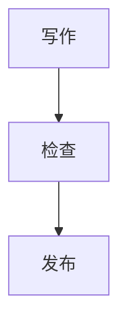

# 内容写作指南

适用于创建、编辑和预览 Blog、Trace、Saying。首次运行项目见 [开发指南](./DEVELOPMENT.md#环境与本地运行)；发布操作使用 [独立内容发布](./DEVELOPMENT.md#独立内容发布)。

## 选择内容类型与目录

| 类型   | 用途                     | 目录                   | 列表入口   |
| ------ | ------------------------ | ---------------------- | ---------- |
| Blog   | 长文、学习笔记、项目总结 | `src/content/blog/`    | `/blog`    |
| Trace  | 生活、思考和过程记录     | `src/content/traces/`  | `/traces`  |
| Saying | 引文、短句及补充说明     | `src/content/sayings/` | `/sayings` |

正文可以是 Markdown 或 MDX。有随文图片时使用独立目录中的 `index.md`／`index.mdx`，图片与正文一起纳入 Git。已发布内容的路径是公开链接的一部分，更名或移动前核对现有引用。`tags` 为保留路径，开启归档分页时不能使用纯数字内容 ID。

## 创建内容

在仓库根目录执行：

```powershell
bun run new --type blog --folder --language 中文 "新的文章"
bun run new --type trace --folder "一段记录"
bun run new --type saying --author "作者" --source "出处" "一句值得收藏的话"
bun run new --type blog --mdx --dry-run "预览创建结果"
```

| 选项                   | 行为                                                                   |
| ---------------------- | ---------------------------------------------------------------------- |
| `--type`               | 选择 blog、trace 或 saying，默认 Blog                                  |
| `--folder` / `-f`      | 创建独立目录与 index 文件                                              |
| `--mdx` / `-m`         | 创建 MDX 文件                                                          |
| `--slug`               | 指定安全的单一路径名称；已有同名 Markdown、MDX 或目录 index 会拒绝创建 |
| `--description`        | 摘要；Blog 未提供时先使用标题，需要根据正文完善                        |
| `--language`           | Blog 语言；旧 `--lang` / `-l` 仍兼容                                   |
| `--author`、`--source` | Saying 作者和出处                                                      |
| `--dry-run`            | 只显示目标路径和内容，不写文件                                         |
| `--publish`            | 创建时写入 `draft: false`；默认创建草稿                                |
| `--draft` / `-d`       | 明确创建草稿，不能与 `--publish` 同时使用                              |

命令以 YAML 序列化标题和文本，支持引号及多行内容。手动修改 frontmatter 时保持合法 YAML；完整参数见 [创建脚本](../scripts/new-content.mjs)。

## 填写元数据

下面三个完整示例均为草稿。实际填写对应内容日期，把字段放在文章开头的两行 `---` 之间。字段校验见 [内容 schema](../src/content.config.ts) 和 [共享校验](../src/lib/content-validation.ts)。

### Blog

```yaml
title: 一次周末记录
description: 记录这次出行中值得留下的片段。
publishDate: 2026-10-08T15:00:00+08:00
language: 中文
tags:
  - 生活
draft: true
```

Blog 必填标题、摘要和发布日期；标题最长 60 字符，摘要最长 160 字符。可选 `updatedDate`、`heroImage`、`language`、`comment`、`pin`，评论默认开启，`pin` 默认 `false`。页面已输出主标题，正文从二级标题开始。

`pin: true` 让文章在 Blog 主列表和该文章所属的 Blog 标签结果页置顶，排序发生在分页之前。多篇置顶文章之间沿用编辑日期倒序，同日期使用稳定标识排序。置顶只在这些列表卡片中显示标记；Home 最近更新、时间线、年份归档、相邻文章和 RSS 保持各自的顺序。增加这一能力不会自动为现有文章置顶。

`language` 保存页面直接显示的语言名称：中文文章填写 `中文`，英文文章填写 `English`。卡片与阅读页直接显示字段原值；按正文的主要叙述语言填写，中文正文中的英文术语和代码不改变文章语言。

### Trace

```yaml
title: 一段周末记录
description: 留下沿途的见闻。
publishDate: 2026-10-08T15:00:00+08:00
tags:
  - 生活
draft: true
```

Trace 必填标题和发布日期；标题最长 80 字符，可选摘要最长 180 字符。可选更新时间与封面。需要跨版本固定配图时填写真实封面；无封面条目的备用图可能因新增内容而重新分配。

### Saying

```yaml
text: Know thyself.
originalText: Know thyself.
author: 古希腊德尔斐神谕
source: 德尔斐神谕
tags:
  - 自省
draft: true
```

Saying 必填 `text`，可选 `originalText`、`author`、`source`、`sourceUrl`、`tags`。引文与原文最长 500 字符，作者最长 80 字符，出处最长 160 字符；`sourceUrl` 只接受 HTTP/HTTPS。不添加日期或 `originalLanguage`。正文可以补充说明；不确定的作者或出处应如实注明。

### 日期与标签

内容日期展示使用 `Asia/Shanghai`；明确时刻建议带时区。`updatedDate` 不得早于 `publishDate`。未来日期不会自动延迟公开，发布状态仍由 `draft` 控制。

修改已发布 Blog 或 Trace 的正文、影响阅读的元数据或随文媒体时，必须维护 `updatedDate`，使其对应本次内容实际修改时间。`publishDate` 保留原始发布日期；用户明确要求修正、保留或指定日期时遵从，不能让脚本的执行时间覆盖用户指定的日期。仅修改网站代码、样式或重新部署时，不推进文章更新时间。

Git 提交、构建和部署不会自动维护这些日期。日期维护必须在正式构建之前完成，更新后重新构建，再核对相关卡片、详情及适用 RSS 中的日期显示。

日期维护命令递归扫描工作区中的全部 Blog，包括草稿。先预览变化范围，再按本次任务范围使用：

```powershell
bun run date --dry-run
bun run date
```

脚本的行为与边界如下：

- 已有基准记录且内容指纹变化时，以命令执行时刻生成 `updatedDate`，且不早于 `publishDate`。单独修改 `updatedDate` 不会再次触发日期更新。
- 首次发现文章或缺少旧记录时，只登记当前基准，不修改文章的 `updatedDate`；首次建立或重建记录不能证明更新时间已经正确。
- 脚本只处理 Blog，不处理 Trace；内容指纹也不包含随文图片、音频或视频文件的字节，因此单独替换媒体不会触发自动更新。

首次登记、记录缺失、Trace 或单独修改随文媒体时，需要直接核对并维护对应条目的日期字段。明确保留或指定日期的条目，也需单独处理。Saying 沿用无日期的 schema。

应用模式可能更新正文日期与 `scripts/blog-metadata.json`。执行前检查只读结果，避免更新无关内容；执行后检查实际字段和文件差异，将本次日期维护产生的必要记录随相关内容提交。不能仅凭命令退出成功或 CI 通过认定日期已经正确。脚本按相对路径保存校验记录，任一文章解析失败会停止整批写入，并保留原有 CRLF 换行。

标签按内容类型分开，单项最长 80 字符；校验会去除两端空白、进行 NFC 规范化、小写化并去重。标签路径由程序生成，frontmatter 保存可读标签文字。

## 封面与正文图片

文章图片优先与 `index.md` 放在同一目录，通过相对路径引用。源文件也需要提交；网站构建不能依赖仓库外的素材备份。

Blog 增加封面字段：

```yaml
heroImage:
  src: ./cover.jpg
  alt: 湖面与岸边的树木
```

Trace 增加封面字段：

```yaml
cover: ./cover.png
coverAlt: 湖面与岸边的树木
```

Trace 设置 `cover` 时必须同时填写 `coverAlt`。Blog 封面也应提供描述图片内容的替代文本。正文图片使用：

```markdown

```

文件名和扩展名应与实际文件一致。JPG、JPEG、PNG、WebP 等符合预算的源图片可以直接使用；照片无需统一预转 WebP，截图可保留 PNG。透明图片应选择支持透明度的格式。

封面通过 Astro `image()` 读取元数据，阅读页和 Markdown 中相对引用的本地图片由构建管线处理。源文件继续保留。`public/` 中的文件原样复制到发布目录，因此不能在其中存放仅供备份的素材。

### 图片预算

| 格式        | 建议最大体积 | 硬限制 |
| ----------- | ------------ | ------ |
| JPG / JPEG  | 512 KiB      | 2 MiB  |
| PNG         | 1 MiB        | 5 MiB  |
| WebP / AVIF | 512 KiB      | 2 MiB  |

超过建议值产生告警，超过硬限制检查失败；源文件与产物均受检查，构建优化不免除源文件检查。预算以 [资源检查脚本](../scripts/check-asset-budget.mjs) 为准。较大的照片先按实际用途缩小或压缩，保留必要清晰度、主体和比例。

在完成新构建后运行 `bun run check:assets`。公共图库、Hero 候选和图标的维护见 [公共素材](./DEVELOPMENT.md#公共素材维护)，卡片显示位置见 [裁剪工作台](./MEDIA_WORKBENCH.md)。

## 普通代码块

代码块支持 Shiki 的高亮、增删行与转义标记。独立注释中的 `[!code highlight]`、`[!code ++]` 和 `[!code --]` 作用于下一行，JSX、HTML、Python 等注释同样适用；使用 `[\!code highlight]` 可以展示标记文字。

超过 15 个逻辑行的普通代码块默认收起至约 15rem，可用按钮展开或收起；复制按钮始终复制完整源码。关闭 JavaScript、打印和 RSS 中保留完整代码。Mermaid 使用下述独立图表交互。

## Mermaid 图表

Blog、Trace、Saying 的 Markdown 和 MDX 正文均可直接使用 `mermaid` 围栏，无须增加 frontmatter 或导入组件：

````markdown

````

图表由 Pele 在开发服务器或构建环境中生成内联 SVG，配色跟随网站主题，保留源码显式方向。宽图可放大、缩小、平移与重置；支持触控、Ctrl/⌘ 加滚轮，以及图表获得焦点后的 `+`、`-`、`0` 和方向键。普通滚轮继续滚动文章。关闭 JavaScript 后仍可阅读图表和横向滚动宽图。源码保存在“查看源码”中，可使用“复制源码”。支持 `accTitle` 和 `accDescr` 的类型使用它们提供可访问名称、图注和搜索文字，建议填写清楚的中文说明；思维导图等类型遵循其支持的语法。打印使用完整浅色图表，RSS 使用同源 PNG。

支持固定 Pele 版本内置的 Mermaid 图表类型，其布局与 Mermaid 原生渲染不同。图表使用固定 Noto Sans SC 字体和同源字体子集，缺少字形时报告错误。源码限制为 50000 个字符，流程图连线限制为 500 条，SVG 输出限制为 4000000 个字符。图内图片、外部资源、自定义图标和链接交互不启用。站点控制字体和安全参数；正文显式样式中的固定颜色仍按 Pele 的语义显示，不随主题变化。

图表生成无需安装 Chromium，开发环境见 [开发指南](./DEVELOPMENT.md#mermaid-运行环境)。生成失败会报告文章路径及可取得的错误行号，并阻止对应页面渲染或构建；修正源码后重新预览。生成资源由程序维护，作者只提交正文，不手工修改缓存或派生图片。

## 草稿与预览

新建命令默认 `draft: true`；普通列表、详情页在开发服务器和生产构建中均过滤草稿。需要通过这些页面预览时，将对应条目设为 `draft: false`，提交前核对公开意图。创建时的 `--publish` 只改变该字段，实际部署仍需发布流程。

运行 `bun run dev` 查看内容。Pagefind 索引在构建时生成，搜索和最终产物应通过 [生产预览](./DEVELOPMENT.md#环境与本地运行) 检查。修改正文后需要重新构建生产预览。内容层的 preview 模式由调用者显式启用，普通路由没有启用它。

## 发布前核对

1. 核对标题、摘要、原始发布日期、本次内容更新时间、草稿状态、引文来源、标签和正文链接；日期维护先于正式构建完成。
2. 核对本地素材是否提交、封面是否存在、替代文本是否正确、资源预算是否满足。
3. 使用最新构建检查正文、列表、详情、搜索与 RSS 中应有的展示，并核对相关卡片、详情及适用 RSS 的日期；默认 RSS 只收录 Blog。
4. 新增外部图片、音频、视频、iframe、脚本或样式需要按精确资源审阅，现有服务的允许范围不自动扩大到正文。来源与使用条件见 [素材说明](./THIRD_PARTY_NOTICES.md)。
5. 确认只修改正文、元数据、随文素材及必要日期维护记录，且兼容当前 `main`，再按 [独立内容发布](./DEVELOPMENT.md#独立内容发布) 创建分支、检查并发布。需要新 schema、模板、组件、配置或样式时，先按网站功能流程发布相应代码。

公开个人事实和历史内容时遵循已明确的范围；相关决定见 [历史确认记录](./archive/OWNER_CONFIRMATION_RECORD.zh-CN.md)。
