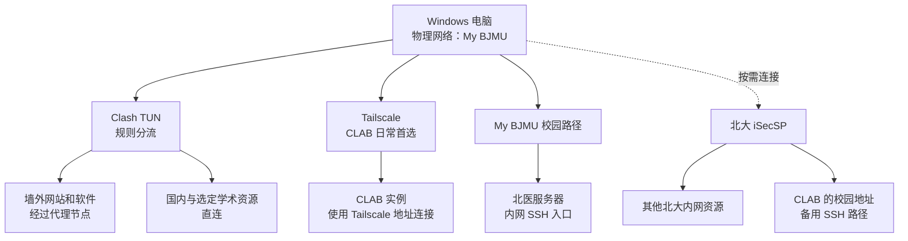
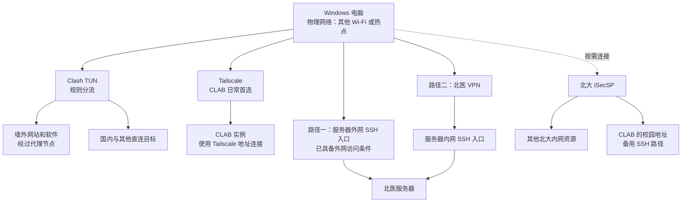

作为一个北京医科大学的学生，大多数时候连接北医的 My BJMU（至今仍不知道为什么不和本部统一使用 Pku 及 Pku Secure)，偶尔使用其他 Wi-Fi 或热点。我日常既需要墙外网站和软件，也需要通过 SSH 连接北大 CLAB 与北医服务器，频繁的切换、开关代理让人身心俱疲。

> 人在北医，干什么都心酸（）

因此我希望这些需求尽量能在同一网络连接下同时满足，减少为了访问不同资源反复切换网络的操作。
这篇文章记录我围绕这些需求配置代理、远程连接和校园 VPN 的过程，以及遇到的 DNS、分流和路由问题及解决方案。

## 一、本文解决什么问题

本文面向需要让**代理访问与内网服务器连接同时工作**的场景。典型需求包括：

- 使用需要代理的网站、API 和软件，包括命令行工具与后台程序；
- 通过 SSH 连接校园内网实例，例如北大 CLAB；
- 访问实验室或校园服务器，并根据当前网络选择内网、外网或 VPN 入口。

这些连接分别可用时，共同启用仍可能出现问题：打开代理后校园资源无法访问，连接校园 VPN 后原有服务器的 SSH 路径发生变化，或者换到热点后仍然使用旧校园网的网关。逐个关闭客户端、切换网络，虽然可能暂时恢复某项访问，却增加了日常操作。

**本文希望达到的效果是：优先让常用校园网下的代理服务和服务器连接同时可用，再兼顾其他 Wi-Fi、热点下的访问，尽量减少反复切换网络和开关客户端。** 具体配置围绕 DNS、代理分流、服务器接入路径和 Windows 路由展开，并通过真实连接检查它们能否共同工作。

**适用条件：** 本文使用 Windows 11，配置从已有可用代理节点、服务器 SSH 账号和接入条件的状态开始。Clash 是我的实际客户端，v2rayN 可以配置相同的分流目标。Tailscale 部分还需要电脑和目标服务器能够运行 Tailscale，并加入同一 Tailnet；使用校园 VPN 路径的目标按学校提供的接入方式处理。

下面以我的北大、北医网络和服务器为例。其他学校或实验室可以参考路径划分和排障方法，再根据自己的域名、网段、客户端与服务器入口调整配置。

## 二、我的接入条件与整体方案

### 1. 本例中的网络与服务器入口

My BJMU 已经提供访问我的北医服务器的校园路径。墙外网站和软件需要代理，CLAB 实例则需要北大内网或 Tailscale 路径；这些访问条件决定了下面的分流安排。

我使用的 CLAB 实例有 `10.129.*` 私有地址，需要先具备到达相应北大内网的路径。SSH 用户名和私钥解决认证问题，连接请求仍然需要先到达服务器的 SSH 端口。我的具体实例与地址在后面的配置中作为示例列出。

北医服务器支持内网、外网两种访问方式，我在本机 SSH 配置中为它定义了两个别名：

- `bjmu-inner`：指向通过北医网络访问的入口，对应 `211.71.48.121:22`；
- `bjmu-outer`：指向可以从外部网络直接连接的入口。

这两个名称由我自行定义，分别指向同一台服务器的不同访问入口。SSH 配置中的 `Host` 定义别名，`HostName`、`Port` 等字段指定实际连接目标。连接 My BJMU 时，我使用内网入口；使用其他网络时，可以直接连接外网入口，也可以先连接北医 VPN，再使用内网入口。只有内网入口的服务器，需要通过相应校园网络、VPN 或其他已有路径访问。

后文保留实际配置中的名称和数值。SSH 别名、代理组名和服务器标签可以自行定义，相关引用需要一致；实例数量按需确定，IP、端口、用户名、密钥路径、网卡编号和网关填写自己的实际值。接口编号、网关和延迟快照来自我在 2026 年 7 月的记录。

我实际使用 Clash 处理代理分流；CLAB 日常优先使用 Tailscale，iSecSP 保留为备用；北医服务器根据当前网络选择对应入口。两种网络下的组合如下。

### 2. My BJMU：优先保证三类需求同时满足

连接 My BJMU 时，日常组合是：

- 墙外网站和软件通过 Clash 代理；
- CLAB 通过 Tailscale 连接；
- 北医服务器使用可从 My BJMU 访问的内网入口，我为它定义的别名是 `bjmu-inner`；
- 需要其他北大内网资源或 CLAB 备用路径时，再连接 iSecSP。



这个组合让日常连接 CLAB 时可以省去启动 iSecSP 的操作。需要启用 iSecSP 时，再检查它下发的路由是否影响 `bjmu-inner`；后文的 `/32` 主机路由用于处理这一具体冲突。

### 3. 其他网络：保留代理与 CLAB 路径，选择北医服务器入口

连接其他 Wi-Fi 或热点时，墙外服务继续使用代理，CLAB 继续优先使用 Tailscale。

北医服务器根据实际入口选择路径：已提供外网入口时，可以直接连接该入口；需要使用内网入口时，先通过北医 VPN 建立路径，再连接服务器。我的对应别名是 `bjmu-outer` 和 `bjmu-inner`。



图中的北医服务器两条路径按需选择。外网入口依赖服务器实际提供的地址、端口和访问权限，其他人的服务器未必具备相同条件。

如果启用 iSecSP 作为 CLAB 的备用路径，同时又使用北医 VPN，就需要检查两个 VPN 共同运行时的路由和 DNS。这种组合的效果应当根据当前网络验证。

### 4. 为什么保留这些选择

最初，我通过 iSecSP 连接 CLAB。后来发现 Tailscale 更方便：电脑和实例在线、权限配置正确时，就能通过对应地址建立 SSH，日常减少了一次校园 VPN 的连接操作。

因此，现在 CLAB 优先使用 Tailscale，iSecSP 保留为备用和其他北大内网资源的接入工具。北医服务器则保留内外两个入口，以适应不同的网络条件。

目前通过不同 SSH 别名手动选择路径，没有配置自动故障切换。选择的依据是当前网络、目标资源和连接状态，主要场景仍然是 My BJMU 下三类需求的共同使用。

## 三、配置 Clash，让代理与校园连接共同工作

我实际使用的是 Clash Verge Rev，代理核心为 Mihomo，下面的操作和配置片段都以它为例。**v2rayN 也可以按照相同的分流目标配置**：需要代理的服务经过代理节点，校园目标和服务器入口保留适用的直连路径，并检查 DNS 与 TUN 路由。

两种客户端使用各自的配置格式和界面。我的日常选择是 Clash，v2rayN 保留为备用。

### 1. 分清 DNS、代理规则和系统路由

DNS 决定取得什么地址。Mihomo 的 Fake-IP 模式会为域名返回占位地址，再根据域名映射处理连接。我的配置使用 `198.18.0.1/16`，所以普通网站解析到 `198.18.*` 可以是正常现象。

代理规则决定怎样处理流量。Clash 中的 `DIRECT` 表示使用直连出站，不经过所选代理节点。

Windows 路由决定实际出口。当物理 Wi-Fi、校园 VPN 和其他虚拟接口同时存在时，系统仍然需要根据目标地址选择路由。

因此，Clash 中配置了 `DIRECT`，还需要继续确认 Windows 最终把连接交给了哪个接口。

### 2. 使用规则模式和 TUN

原环境采用以下日常状态：

| 设置             | 状态               |
| ---------------- | ------------------ |
| Clash 模式       | 规则               |
| TUN              | 开启               |
| Windows 系统代理 | 关闭               |
| DNS 覆写         | 开启               |
| 代理节点         | 选择实际可用的节点 |

Clash 与 v2rayN 每次只运行一个。切换时先关闭旧客户端的 TUN，再从托盘退出旧客户端，随后启动另一个。

Tailscale 和校园 VPN 按各自职责运行。

### 3. 为校园目标配置直连规则

先确定校园目标、VPN 入口和服务器地址，再为需要直连的目标添加规则。我的代理组命名为 `AI-PROXY`，下面保留这组实际配置作为示例。合并时需要确保代理组已经存在；使用其他名称时，将规则中的代理组引用一并替换。

域名和网段也需要按实际资源调整。下面包含我使用的北大、北医、上交及 CARSI 相关条目，读者可以根据自己的访问范围增删：

```yaml
rules:
  - DOMAIN,arrayvpn.pku.edu.cn,DIRECT
  - DOMAIN,vpn.pku.edu.cn,DIRECT
  - DOMAIN,webvpn.pku.edu.cn,DIRECT

  - DOMAIN-SUFFIX,pku.edu.cn,DIRECT
  - DOMAIN-SUFFIX,bjmu.edu.cn,DIRECT
  - DOMAIN-SUFFIX,hsc.pku.edu.cn,DIRECT
  - DOMAIN-SUFFIX,sjtu.edu.cn,DIRECT
  - DOMAIN-SUFFIX,carsi.edu.cn,DIRECT

  - IP-CIDR,106.120.124.249/32,DIRECT,no-resolve
  - IP-CIDR,111.205.231.51/32,DIRECT,no-resolve
  - IP-CIDR,10.0.0.0/8,DIRECT,no-resolve
  - IP-CIDR,115.27.0.0/16,DIRECT,no-resolve
  - IP-CIDR,162.105.0.0/16,DIRECT,no-resolve
  - IP-CIDR,202.112.176.0/20,DIRECT,no-resolve
  - IP-CIDR,211.71.48.0/20,DIRECT,no-resolve
  - IP-CIDR,211.82.64.0/20,DIRECT,no-resolve
  - IP-CIDR,222.28.96.0/20,DIRECT,no-resolve
  - IP-CIDR,222.29.0.0/16,DIRECT,no-resolve

  - GEOIP,private,DIRECT,no-resolve
  - GEOSITE,cn,DIRECT
  - GEOIP,CN,DIRECT,no-resolve
  - MATCH,AI-PROXY
```

规则按顺序匹配，需要将这些条目安排在可能提前匹配相同目标的规则之前。[Mihomo 路由规则文档](https://wiki.metacubex.one/config/rules/)

原配置还保留了论文数据库和出版商的直连规则。选择直连只是在确定网络路径，全文权限仍然取决于学校订购范围、出口身份或 CARSI 登录状态。

为服务器外网入口设置规则时，需要以 SSH 配置中的实际目标为准。如果它的域名或 IP 没有被已有直连规则覆盖，也应补充对应规则。

下面以我的 `bjmu-outer` 别名检查连接参数，使用时换成自己已经定义的别名：

```powershell
ssh -G bjmu-outer |
  Select-String '^(hostname|port|user|proxyjump|proxycommand) '
```

其中的 `hostname` 和 `port` 才是需要进一步检查的目标。SSH 别名本身不会自动成为 Clash 的域名规则。

### 4. 让校园域名返回真实地址

在 Clash Verge Rev 的 DNS 覆写中，将需要返回真实地址的校园和 VPN 域名加入 Fake-IP 过滤。下面沿用我的域名列表，使用时按学校和目标服务调整：

```yaml
dns:
  enable: true
  enhanced-mode: fake-ip
  fake-ip-range: 198.18.0.1/16
  fake-ip-filter-mode: blacklist
  fake-ip-filter:
    - '*.lan'
    - '*.local'
    - '*.arpa'
    - localhost
    - +.pku.edu.cn
    - +.bjmu.edu.cn
    - +.hsc.pku.edu.cn
    - +.sjtu.edu.cn
    - +.carsi.edu.cn
```

这是需要合并到已有 DNS 配置中的片段。在 blacklist 模式下，匹配过滤项的域名不会被分配 Fake-IP。[Mihomo DNS 文档](https://wiki.metacubex.one/config/dns/)

保存后，打开 DNS 覆写总开关，检查当前核心配置，再查询实际使用的域名。以下是我配置中的几个例子：

```powershell
Resolve-DnsName arrayvpn.pku.edu.cn
Resolve-DnsName clab.pku.edu.cn
Resolve-DnsName models.sjtu.edu.cn
```

这些目标应按本文配置返回真实地址。出现 `198.18.*` 时，需要检查覆写是否生效，以及是否残留旧缓存。

Fake-IP 过滤只负责真实地址与占位地址的选择。仅在内网提供解析的域名，还需要对应的内网 DNS 条件。

### 5. 排除需要由其他接口处理的目标

原环境的 TUN 使用 Mixed、自动路由、关闭严格路由、自动选择出口接口，MTU 为 `1500`，代理配置中的 IPv6 关闭。

根据要交给校园 VPN、物理网络等路径处理的目标，设置 TUN 排除网段。下面是我的配置片段，需要根据自己的目标地址与网段调整：

```yaml
tun:
  route-exclude-address:
    - 106.120.124.249/32
    - 111.205.231.51/32
    - 10.0.0.0/8
    - 115.27.0.0/16
    - 162.105.0.0/16
    - 202.112.176.0/20
    - 211.71.48.0/20
    - 211.82.64.0/20
    - 222.28.96.0/20
    - 222.29.0.0/16
```

`route-exclude-address` 用于在自动路由中排除指定目标，让系统继续通过其他路径处理连接。[Mihomo TUN 文档](https://wiki.metacubex.one/config/inbound/tun/)

在我的验证中，CLAB 的 Tailscale 地址由 Tailscale 管理的精确主机路由处理。读者需要检查自己每个目标的实际选路。使用校园 VPN 或服务器外网入口时，也按对应地址检查路径。

### 6. 使用 v2rayN 时，对应配置这些项目

上述访问安排也可以在 v2rayN 中实现。原记录使用 v2rayN 7.22.7，配置了独立的校园共存规则，关键项目如下：

| 配置目标             | Clash 中的设置        | v2rayN 中的对应设置                     |
| -------------------- | --------------------- | --------------------------------------- |
| 按目标分流           | 规则模式、`rules`     | 启用校园共存路由规则                    |
| 校园与服务器直连     | `DIRECT` 规则         | `direct` 出站规则                       |
| 其余需要代理的服务   | `AI-PROXY`            | `proxy` 出站                            |
| 覆盖命令行与后台程序 | 开启 TUN              | 开启 TUN                                |
| 为其他接口保留路径   | TUN 排除自定义网段    | TUN 路由排除地址                        |
| 校园域名取得真实地址 | Fake-IP 过滤          | 检查实际 DNS 结果；原配置未启用 Fake-IP |
| 避免额外系统代理设置 | 关闭 Windows 系统代理 | 清除系统代理                            |

原 v2rayN 配置同样开启自动路由、关闭严格路由，使用 Mixed，MTU 为 `1500`。

因此，使用 v2rayN 时，可以保留本文对访问路径、校园网段和验证方法的安排，再通过对应设置实现。切换客户端后，需要重新检查 DNS、系统选路和真实连接；Clash 与 v2rayN 的 TUN 每次只启用一个。

## 四、用 Tailscale 日常连接 CLAB

这部分适用于个人电脑和待连接实例已经安装 Tailscale、加入同一 Tailnet，且服务器原有 OpenSSH、用户和密钥已经可用的情况。按实际需要为每台实例配置权限和 SSH 入口即可。

### 1. 确认设备在线

在本机运行：

```powershell
tailscale status
```

先从设备列表确认目标在线，并记录各实例的 Tailscale 地址。我当时使用三台实例，下面保留这份记录作为示例：

| 实例的 SSH 别名（示例）  | 校园地址         | Tailscale 地址    |
| ------------------------ | ---------------- | ----------------- |
| `clab-obsidian-sync`     | `10.129.243.141` | `100.123.144.40`  |
| `clab-obsidian-ingest`   | `10.129.246.230` | `100.107.106.39`  |
| `clab-treehole-observer` | `10.129.244.254` | `100.106.198.120` |

这些名称是我为各实例定义的本地 SSH 别名。读者需要记录自己的目标，实例数量和名称按实际需要确定，再从设备列表取得对应地址。

### 2. 开放 SSH 网络权限

为目标服务器配置网络访问权限。我的这些实例使用 `tag:obsidian-server` 标签，原策略允许指定用户身份下的设备访问它们的 TCP 22、TCP 443 和 ICMP。标签名称可以按用途自行定义，`tagOwners` 与 `dst` 中的名称需要一致。

下面保留其结构，将账号替换为示例值：

```json
{
  "tagOwners": {
    "tag:obsidian-server": ["your-account@example.com"]
  },
  "grants": [
    {
      "src": ["your-account@example.com"],
      "dst": ["tag:obsidian-server"],
      "ip": ["tcp:443", "tcp:22", "icmp:*"]
    }
  ]
}
```

需要替换实际用户身份和选定的服务器标签，并确认目标服务器已经应用该标签。已有其他策略时，合并相关条目，保留仍然有效的权限。

示例中的 TCP 22 对应默认 SSH 端口；服务器使用其他端口时，按实际端口配置。TCP 443 和 ICMP 是我原配置保留的其他访问能力，是否需要开放取决于目标服务和诊断需求。多个匹配授权会叠加，因此还需要检查是否存在范围更大的放行规则。[Tailscale Grants 语法](https://tailscale.com/docs/reference/syntax/grants)

这组配置通过 Tailscale 网络访问原有 OpenSSH，服务器保持 `RunSSH=false`，用户和私钥沿用原配置。

### 3. 增加 SSH 别名

为需要连接的实例添加 SSH 别名，把 `HostName` 指向它的 Tailscale 地址。我保留原来的校园地址入口，并为 Tailscale 路径的别名增加 `-ts` 后缀；名称和后缀都可以自行选择。

Windows 用户 SSH 配置位于：

```text
%USERPROFILE%\.ssh\config
```

下面用我的三台实例演示。为自己需要连接的实例添加对应的 `Host` 配置块，替换别名、Tailscale 地址、用户名和私钥路径：

```ssh-config
Host clab-obsidian-sync-ts
    HostName 100.123.144.40
    User your-clab-user
    IdentityFile ~/.ssh/id_ed25519
    HostKeyAlias 10.129.243.141

Host clab-obsidian-ingest-ts
    HostName 100.107.106.39
    User your-clab-user
    IdentityFile ~/.ssh/id_ed25519
    HostKeyAlias 10.129.246.230

Host clab-treehole-observer-ts
    HostName 100.106.198.120
    User your-clab-user
    IdentityFile ~/.ssh/id_ed25519
    HostKeyAlias 10.129.244.254
```

`HostKeyAlias` 指定 SSH 查询和保存主机密钥时使用的名称。[OpenSSH 配置手册](https://man.openbsd.org/ssh_config#HostKeyAlias)

我的旧地址已有受信任的主机密钥记录，所以新路径继续使用相同身份进行校验。示例中的 `HostKeyAlias` 用于这一条件；采用时需要确认两个地址确实对应同一台服务器，并填写已有记录使用的名称。新建连接时，应根据服务器可信的主机密钥信息核对身份，按需设置这个可选字段。

保存后，使用自己定义的别名连接所需实例。以这份配置为例：

```powershell
ssh clab-obsidian-sync-ts
ssh clab-obsidian-ingest-ts
ssh clab-treehole-observer-ts
```

### 4. 验证与北医服务器同时连接

选择一台实例，检查它的实际 Tailscale 地址和 SSH 端口。下面用表中第一台实例的地址演示：

```powershell
Find-NetRoute -RemoteIPAddress 100.123.144.40

Test-NetConnection 100.123.144.40 `
  -Port 22 `
  -InformationLevel Detailed
```

随后建立真实 SSH 会话，并同时连接北医服务器。

当时在 My BJMU 下验收时，我退出 iSecSP，确认其 TAP 接口断开、`10.0.0.0/8` VPN 路由消失，再同时保持三台 CLAB 和 `bjmu-inner` 的 SSH 连接。

四个会话均成功建立。CLAB 使用 Tailscale 地址，北医服务器使用 My BJMU 路径。这是主要使用场景中已经取得的共存结果。

### 5. 检查当前连接质量

下面是我当时三台实例的测量记录，路径和延迟会随网络条件变化：

| 实例                     | 连接方式       | 延迟快照   |
| ------------------------ | -------------- | ---------- |
| `clab-obsidian-sync`     | direct         | 约 5～8 ms |
| `clab-obsidian-ingest`   | DERP，香港区域 | 约 136 ms  |
| `clab-treehole-observer` | direct         | 约 5～7 ms |

查看自己的目标时，可以运行 `tailscale status`，再对相应的 Tailscale 地址执行 `tailscale ping`。例如：

```powershell
tailscale status
tailscale ping 100.107.106.39
```

设备间无法直连时，Tailscale 可以使用中继。网络条件变化后，路径也可能改变；测试开始时短暂出现 DERP，后续仍可能转为 direct。[Tailscale 连接类型说明](https://tailscale.com/docs/reference/connection-types)

Tailscale 连接异常，或者当前中继表现不适合任务时，可以改用 iSecSP 路径。

## 五、按需使用 iSecSP，并处理 My BJMU 下的路由冲突

目标需要通过北大内网地址访问时，连接 iSecSP，等待连接和路由下发稳定，再使用指向校园地址的 SSH 别名。以下用我的别名举例，连接时换成自己的配置，并按需选择实例：

```powershell
ssh clab-obsidian-sync
ssh clab-obsidian-ingest
ssh clab-treehole-observer
```

原环境连接的入口是 `arrayvpn.pku.edu.cn`，也是北大官方 iSecSP 配置说明提供的入口。[北京大学 VPN 配置说明](https://its.pku.edu.cn/service_1_vpn.jsp)

下面的主机路由用于处理实际观察到的出口冲突。配置前先检查目标的选路；路径已经正确时，无需增加这条路由。案例中的目标 IP、接口编号和网关均来自我的环境。

### 1. 冲突是怎样发生的

最初使用 iSecSP 连接 CLAB 时，它向 Windows 下发了两条相关路由：

| 目标网段         | 接口                | 下一跳        |
| ---------------- | ------------------- | ------------- |
| `10.0.0.0/8`     | iSecSP，ifIndex `6` | `222.29.24.1` |
| `211.71.48.0/20` | iSecSP，ifIndex `6` | `222.29.24.1` |

第一条提供 CLAB 所需的内网路径。

第二条覆盖 `211.71.48.0` 到 `211.71.63.255`，其中包含北医服务器的 `211.71.48.121`。

当时 My BJMU 提供默认路由 `/0`，iSecSP 提供更具体的 `/20`。Windows 根据最长前缀匹配，把这个目标送入了 iSecSP，影响了原本通过 My BJMU 建立的访问路径。

Clash 已经将目标直连并排除出 TUN，Windows 仍然会继续执行这次出口选择。

### 2. 为北医服务器增加精确主机路由

针对这次冲突，我单独指定了 `211.71.48.121/32`：

| 目标               | 出口     |
| ------------------ | -------- |
| `211.71.48.121/32` | My BJMU  |
| `211.71.48.0/20`   | iSecSP   |
| `0.0.0.0/0`        | 默认出口 |

`/32` 只匹配这一台主机，比 `/20` 更具体，因此能够让北医服务器继续使用 My BJMU。

这里的关键是前缀长度。降低默认路由的 Metric，无法消除这个差异。

### 3. 先确认真实接口

当时我的物理 Wi-Fi 和 VPN 接口都显示为 `iSecSP`：

| ifIndex | 接口名称 | 网卡描述                           | 实际用途           |
| ------- | -------- | ---------------------------------- | ------------------ |
| `19`    | `iSecSP` | MediaTek Wi-Fi 6E                  | My BJMU 物理 Wi-Fi |
| `6`     | `iSecSP` | Array Networks TAP-Windows Adapter | iSecSP VPN         |

需要结合接口编号、描述和地址检查：

```powershell
Get-NetConnectionProfile |
  Select-Object Name, InterfaceAlias, InterfaceIndex

Get-NetAdapter |
  Select-Object ifIndex, Name, InterfaceDescription, Status

Get-NetIPConfiguration
```

下面的命令沿用这次案例：目标为 `211.71.48.121`，物理接口为 `19`，网关为 `172.20.192.1`。用于其他目标时，需要同时替换目标 IP、目标前缀、接口和网关，并检查确实存在相同类型的路由冲突。

### 4. 先验证临时路由

使用管理员 PowerShell，检查是否已有目标主机路由。以下仍以案例中的地址演示：

```powershell
Get-NetRoute -AddressFamily IPv4 -PolicyStore ActiveStore |
  Where-Object {
    $_.DestinationPrefix -eq '211.71.48.121/32'
  }

Get-NetRoute -AddressFamily IPv4 -PolicyStore PersistentStore |
  Where-Object {
    $_.DestinationPrefix -eq '211.71.48.121/32'
  }
```

已有路由时，先检查参数和实际效果。确认不存在后，添加临时路由：

```powershell
New-NetRoute `
  -AddressFamily IPv4 `
  -DestinationPrefix '211.71.48.121/32' `
  -InterfaceIndex 19 `
  -NextHop '172.20.192.1' `
  -RouteMetric 1 `
  -PolicyStore ActiveStore
```

随后查询两类目标：

```powershell
Find-NetRoute -RemoteIPAddress 211.71.48.121
Find-NetRoute -RemoteIPAddress 10.129.243.141
```

当时预期的结果是北医服务器经过 My BJMU，CLAB 校园地址经过 iSecSP。接着建立两个真实 SSH 会话，确认能够同时连接。

### 5. 永久保存及其适用条件

当时临时路由验证通过后，我先精确删除了对应临时路由：

```powershell
Remove-NetRoute `
  -PolicyStore ActiveStore `
  -AddressFamily IPv4 `
  -DestinationPrefix '211.71.48.121/32' `
  -InterfaceIndex 19 `
  -NextHop '172.20.192.1' `
  -Confirm:$false
```

再使用 Windows 自带的命令保存永久路由：

```powershell
route.exe -4 -p ADD `
  211.71.48.121 `
  MASK 255.255.255.255 `
  172.20.192.1 `
  METRIC 1 `
  IF 19
```

`-p` 会保存永久路由，供 TCP/IP 启动时初始化路由表使用。[Windows route 命令说明](https://learn.microsoft.com/en-us/windows-server/administration/windows-commands/route_ws2008)

保存后检查两个存储：

```powershell
Get-NetRoute `
  -PolicyStore PersistentStore `
  -AddressFamily IPv4 `
  -DestinationPrefix '211.71.48.121/32'

Get-NetRoute `
  -PolicyStore ActiveStore `
  -AddressFamily IPv4 `
  -DestinationPrefix '211.71.48.121/32'
```

当时已经确认活动存储和永久存储中存在路由，并完成真实 SSH 验证，没有专门重启电脑测试重新加载。已经存在且正常工作的路由无需重复添加。

这条配置服务于案例中“My BJMU 与 iSecSP 同时运行，且北医目标被送入错误出口”的场景。其他环境需要根据实际选路决定是否添加主机路由。静态配置固定了目标、接口和网关，换到其他网络后需要重新检查。

## 六、在其他网络下继续使用这些服务

切换到其他网络后，先确认代理和远程接入工具能够工作，再根据目标服务器实际提供的入口选择路径。在我的配置中，墙外服务仍然通过 Clash，CLAB 仍然优先通过 Tailscale，北医服务器使用外网入口或北医 VPN。

### 1. 使用北医服务器的外网入口

服务器已经提供外网访问条件、且本机已经配置对应 SSH 别名时，使用该别名连接。以我的外网入口为例：

```powershell
ssh bjmu-outer
```

这里的 `bjmu-outer` 读取本机已有的外网地址、端口和认证信息。读者需要先取得自己服务器的访问参数，再配置相应别名。

### 2. 通过北医 VPN 使用内网入口

需要使用内网入口时，先连接目标所属校园提供的 VPN，再通过对应 SSH 配置连接。以北医服务器和我定义的内网别名为例：

```powershell
ssh bjmu-inner
```

北医提供客户端 VPN，使用医学部统一身份认证账号和动态验证登录，客户端和连接方法以官方指南为准。[北医客户端 VPN 服务说明](https://xxzx.bjmu.edu.cn/fwzn/VPNfw/khdVPN/index.htm)

连接后检查目标的实际内网地址和 SSH 端口。下面沿用我的地址与别名：

```powershell
Find-NetRoute -RemoteIPAddress 211.71.48.121

Test-NetConnection 211.71.48.121 `
  -Port 22 `
  -InformationLevel Detailed

ssh bjmu-inner
```

北医 VPN 和北大 iSecSP 分别承担对应校园的接入任务。使用哪个客户端，需要根据访问目标决定。

### 3. 检查遗留的 My BJMU 路由

如果之前为某台服务器添加了固定校园网出口的主机路由，需要检查它在换网后是否仍然适用。在本文案例中，指向 My BJMU 网关的 `/32` 可能影响通过北医 VPN 访问内网入口。

先查看路由对象和当前选路，以下继续使用案例中的目标地址：

```powershell
Get-NetRoute -AddressFamily IPv4 -PolicyStore PersistentStore |
  Where-Object {
    $_.DestinationPrefix -eq '211.71.48.121/32'
  }

Get-NetRoute -AddressFamily IPv4 -PolicyStore ActiveStore |
  Where-Object {
    $_.DestinationPrefix -eq '211.71.48.121/32'
  }

Find-NetRoute -RemoteIPAddress 211.71.48.121
```

如果确认旧的永久路由仍指向接口 `19`、网关 `172.20.192.1`，且当前已经不使用该路径，可以精确删除：

```powershell
Remove-NetRoute `
  -PolicyStore PersistentStore `
  -AddressFamily IPv4 `
  -DestinationPrefix '211.71.48.121/32' `
  -InterfaceIndex 19 `
  -NextHop '172.20.192.1' `
  -Confirm:$false
```

随后重新查询 ActiveStore。如果相同活动路由仍然存在，再删除对应对象：

```powershell
Remove-NetRoute `
  -PolicyStore ActiveStore `
  -AddressFamily IPv4 `
  -DestinationPrefix '211.71.48.121/32' `
  -InterfaceIndex 19 `
  -NextHop '172.20.192.1' `
  -Confirm:$false
```

删除操作需要管理员 PowerShell；这些命令使用历史参数，执行前必须与实际查到的对象一致。清理后重新检查选路，再测试连接。这里处理的是自己添加的精确主机路由，VPN 下发的校园网段路由由对应客户端管理。

即使使用临时路由，切换 Wi-Fi 后也需要检查其状态。临时路由可能在当前会话中继续存在，不能仅凭已经换网就判断旧配置失效。

## 七、日常使用：分别处理两种接入场景

完成配置以后，根据当前物理网络和目标的接入条件选择路径。下面分别说明校园网与其他网络下的使用流程，继续用 My BJMU 和我的 SSH 别名演示；实际连接时换成自己已经配置的入口。

### 1. 在校园网下使用（以 My BJMU 为例）

先连接日常使用的校园网，启动 Clash，确认规则模式、TUN、DNS 覆写和代理节点正常。使用 Tailscale 的目标需要确认双方在线。本例的校园网是 My BJMU。

通过已配置的 Tailscale 别名连接所需 CLAB 实例。以表中第一台实例为例：

```powershell
ssh clab-obsidian-sync-ts
```

校园网已经具备目标服务器内网访问路径时，使用其内网入口。我的北医服务器可以这样连接：

```powershell
ssh bjmu-inner
```

如果当前校园网不能直接访问该目标，则需要先建立对应的 VPN 等接入路径。保持实际需要的 SSH 会话后，使用需要代理的网站或软件，检查这些连接能否同时工作。

需要北大内网资源，或者准备通过 CLAB 的校园地址连接时，再启用 iSecSP。连接稳定后，使用指向相应校园地址的别名，例如：

```powershell
ssh clab-obsidian-sync
```

VPN 启用后，检查原有服务器连接的实际出口。以我的北医服务器为例：

```powershell
Find-NetRoute -RemoteIPAddress 211.71.48.121
```

如果选路发生变化且影响访问，再根据前文的案例检查是否需要主机路由。已经存在且正常工作的路由无需重复添加。

### 2. 连接其他 Wi-Fi 或热点时

先确认基础网络能够使用，再启动 Clash，检查代理节点和规则分流。确认 Tailscale 双方在线，通过自己定义的别名连接所需实例。

接下来，根据服务器实际支持的访问方式，选择外网入口或校园 VPN 路径。

#### 使用外网入口

服务器已经提供外网访问条件时，使用相应的 SSH 配置。以下仍以我的外网别名演示：

```powershell
ssh bjmu-outer
```

这条流程使用已有的外网地址、端口和认证配置，无需为该连接额外启动北医 VPN。

#### 使用内网入口

需要通过内网入口访问时，先连接目标校园的 VPN，再检查实际地址和端口。以北医服务器为例：

```powershell
Find-NetRoute -RemoteIPAddress 211.71.48.121

Test-NetConnection 211.71.48.121 -Port 22

ssh bjmu-inner
```

如果之前保存了指向旧校园网网关的主机路由，需要检查它是否仍然存在，并按实际对象清理已经不适用的配置。

#### 按需启用 CLAB 的备用路径

Tailscale 连接异常，或者当前路径表现不适合任务时，可以连接北大 iSecSP，再使用指向 CLAB 校园地址的 SSH 配置。

服务器使用外网入口时，继续检查该入口是否正常；同时使用两个校园 VPN 时，则需要检查它们共同运行时的路由和 DNS。

完成连接后，同样保持 CLAB 和北医服务器会话，再使用墙外网站或软件，确认当前网络下的共同使用效果。

### 3. 使用 v2rayN 或切换代理客户端时

上述两种网络场景都可以使用配置完成的 v2rayN。

切换客户端时：

1. 先断开当前校园 VPN；
2. 关闭旧代理客户端的 TUN，并从托盘退出客户端；
3. 启动备用客户端，选择可用节点和校园共存规则；
4. 开启 TUN，保持 Windows 系统代理关闭；
5. 按当前网络重新连接所需 VPN 和 SSH 入口；
6. 检查墙外服务、CLAB 和北医服务器能否共同使用。

我日常仍使用 Clash。v2rayN 保留相同的分流目标和访问路径，作为代理客户端的备用选择。

## 八、用实际连接验证共存效果

验证需要围绕当前场景和实际使用的目标进行，重点检查代理访问与服务器连接能否同时工作。下面沿用我的别名、IP 和默认 SSH 端口演示，检查时替换为自己的参数，并选择当前准备使用的入口。

### 1. 确认实际连接目标

```powershell
ssh -G clab-obsidian-sync-ts |
  Select-String '^(hostname|port|user) '

ssh -G bjmu-inner |
  Select-String '^(hostname|port|user) '

ssh -G bjmu-outer |
  Select-String '^(hostname|port|user) '
```

后续 DNS、路由和端口检查，都针对实际目标进行。

### 2. 检查 DNS 和系统选路

校园域名解析异常时，先查询：

```powershell
Resolve-DnsName arrayvpn.pku.edu.cn
Resolve-DnsName clab.pku.edu.cn
```

应返回真实地址的目标出现 `198.18.*` 时，检查 Fake-IP 过滤、DNS 覆写和当前运行的客户端。修改生效后，如有旧缓存，可以清除：

```powershell
ipconfig /flushdns
```

VPN 反复重连时，还需要结合客户端日志判断原因。

针对实际 SSH 目标查询，下面分别以我的北医入口、CLAB 校园地址和 Tailscale 地址为例：

```powershell
Find-NetRoute -RemoteIPAddress 211.71.48.121
Find-NetRoute -RemoteIPAddress 10.129.243.141
Find-NetRoute -RemoteIPAddress 100.123.144.40
```

根据当前网络判断结果：

- 校园服务器内网入口应使用有效的校园网或对应 VPN 路径；
- CLAB 校园地址应具备到达相应北大内网的路径；
- 通过 Tailscale 访问的地址应由 Tailscale 路径处理。

接口编号和本地地址可能变化，检查时需要结合当前网卡状态。

### 3. 检查端口和真实登录

```powershell
Test-NetConnection 211.71.48.121 -Port 22
Test-NetConnection 10.129.243.141 -Port 22
Test-NetConnection 100.123.144.40 -Port 22
```

外网入口使用其实际地址和端口检查；其他 SSH 入口使用非默认端口时，也需要替换示例中的 `22`。

端口测试确认 TCP 连接，主机身份和用户认证还需要通过真实 SSH 登录验证。超时、连接被拒绝和认证失败应分别处理。认证失败通常说明已经到达 SSH 服务，此时应继续检查用户名、密钥和服务端认证配置。

### 4. 同时保持会话，再使用墙外服务

先保持实际需要的服务器 SSH 会话，再使用需要代理的网站或软件。连接的实例数量按任务需要选择，这样才能检查当前需求是否同时满足。

查看已建立的 SSH 连接：

```powershell
Get-NetTCPConnection -State Established |
  Where-Object {
    $_.RemotePort -eq 22
  } |
  Select-Object RemoteAddress, RemotePort, LocalAddress, State
```

外网入口使用其他端口时，按实际端口调整过滤条件。结合远端地址、本地源地址和系统路由，可以确认连接使用的路径。

如果连接能够建立但速度缓慢，继续检查对应线路：Tailscale 是否经过 DERP，代理节点的建连和传输表现如何，当前 VPN 路径是否稳定。

对我而言，My BJMU 下已经验证的组合是最重要的使用基础。Tailscale 减少了日常连接 CLAB 时启用校园 VPN 的操作，北医服务器保留内外入口，iSecSP 和北医 VPN 则提供按需接入的路径。需要手动选择时，也能根据当前目标明确该使用哪个入口。

## 九、写在最后

折腾完这些，还是想吐槽一句：北医和本部的割裂，有时候从路由表里都能看出来：同样是北大~~吗~~，校园网和 VPN 各有一套。再加上北医网络和vpn都很不稳定，跨学科学习难度与障碍总是在意想不到的地方增加。如果后来看到这篇文章的你，我想大概率是北医修信双的学弟学妹，希望这些记录能让你少绕一点路，希望能为你多腾一点时间留给自己真正想学、想做的事情。
