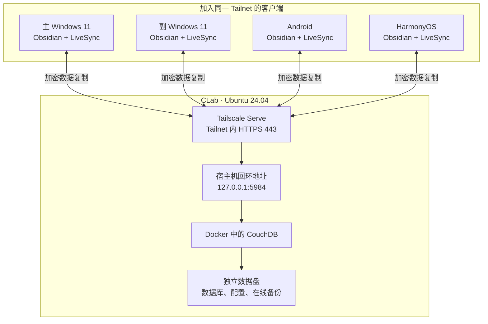
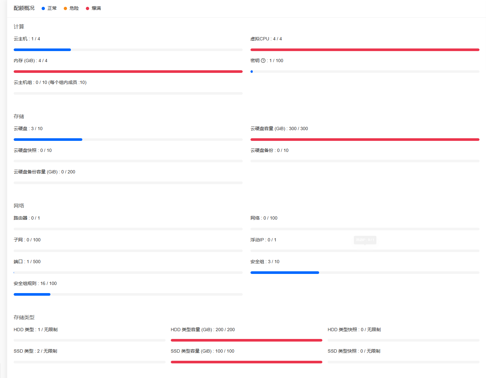
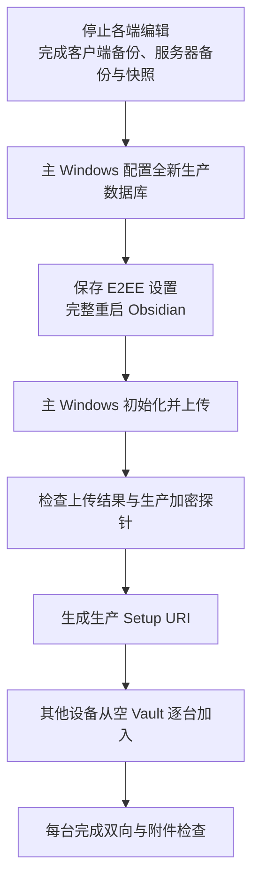

我相信很多人都有下面这个经历：笔记散落在好几个地方：平板上的笔记软件、手机备忘录，还有微信文件传输助手里的对话和 QQ 传过来的文件。每个地方都能留下内容，可是想把这些记录放在一起编辑、整理，就得分别找到它们，再逐处导出、复制。内存占用倒是小事，主要是版本领先落后不好区分，并且容易遗忘。

上面这个问题其实也很好解决，只要有一台方便随身携带、续航也够用的 Mac，就可以把更多记录集中在同一台电脑上。只不过我当时太无知，买了一台厚重的游戏本，耗电也非常快，即使开启省电模式、把亮度调低，续航也只有一小时左右。另一台电脑是多年前的轻薄本，还能用，但同时打开多个软件就会明显卡顿。对于经常需要多开软件的我来说，它只能算备用方案。现有的电脑各有不便，日常记录仍然需要在电脑、手机和平板之间切换。

所以究竟应该如何实现多设备间的同步呢，下面是我最终选取、配置的完整方案，即利用北大CLab服务器，配合 Tailscale 和 LiveSync 搭建 Obsidian 多设备同步。

## 一、同步方案怎么选

我的要求很直接：**希望免费；前期配置复杂一些可以接受，配好以后日常使用要方便、稳定；同步速度没有硬性要求，但当然越快越好。** 我愿意花时间处理安装、网络和服务配置，但希望以后换一台设备时，打开笔记就能继续写，少做几次手动搬运和重复整理。

Obsidian 的 Vault 是一个本地文件夹，因此同步既可以交给 Obsidian 内的插件，也可以由外部工具处理。几条常见路线，在费用、移动端适配、日常操作和维护责任上各有侧重。

### Obsidian Sync：减少服务端维护

[Obsidian Sync](https://obsidian.md/sync) 是官方提供的订阅服务，直接集成在应用中，提供端到端加密、版本历史和选择性同步。服务器的运行和维护交给服务提供方，用户主要处理账号、远端库和客户端设置。

它适合希望尽快开始使用、减少部署与维护操作的人。笔记仍然保留本地副本，离线时可以继续编辑。需要考虑的是持续订阅费用，以及所选套餐的总容量、单文件大小和历史保留范围。就我的需求而言，它的便利很有吸引力，不过我希望使用免费方案，也愿意承担前期配置，因此这次没有采用官方订阅。

### 网盘与 Remotely Save：利用已有的远端存储

把 Vault 放进 OneDrive 等工具管理的目录，是容易想到的办法。桌面端可以沿用已有的文件同步方式，不过移动端需要能够把整个 Vault 保存在 Obsidian 可读写的本地目录中。安装了网盘客户端，并不代表它就能完成这样的双向目录同步。Obsidian 官方也提醒，应让笔记文件始终保留在本地，避免按需下载影响文件访问。[Obsidian 的同步方式说明](https://obsidian.md/help/sync-notes)

另一种做法是使用 [Remotely Save](https://github.com/remotely-save/remotely-save)，由 Obsidian 内的插件访问 WebDAV、S3 兼容存储等服务。它支持设置加密密码，以及定时或保存时同步。已经有合适的远端存储时，可以省去部署 CouchDB 的工作；相应地，需要核对服务费用、接口限制和冲突处理方式，插件同步也依赖 Obsidian 的运行状态。

这条路线能否满足免费的要求，取决于所用存储服务的额度和收费方式。对于需要同时使用电脑、手机和平板的我来说，还要确认每台设备都能直接读写笔记，并在换设备后及时取得修改。具体选择需要结合远端服务和移动端的实际表现。

### Syncthing：直接同步设备上的文件夹

[Syncthing](https://docs.syncthing.net/intro/getting-started.html) 可以直接在设备之间同步 Vault 文件夹，不必把笔记存放在第三方网盘中。同步由独立程序运行，设备上的 Syncthing 保持工作时，可以在 Obsidian 关闭后继续处理文件变化。

它需要持有相应数据的设备能够相互连接。若希望电脑关机以后手机和平板仍能交换修改，可以增加一台持续在线的同步节点。移动端还需要检查可用客户端、目录权限和后台运行条件。

Syncthing 以文件为单位处理并发修改。两端同时修改同一文件时，可能生成需要人工核对的冲突副本；它不会自动理解笔记内容之间的关系。[Syncthing 的同步与冲突处理机制](https://docs.syncthing.net/users/syncing.html)

### Git：保留明确的修改历史

Git 适合希望查看文本差异、保留提交记录，并且能够处理仓库与合并操作的人。[Obsidian Git](https://github.com/Vinzent03/obsidian-git) 可以自动提交、拉取和推送，减少日常手动操作。

自动化之后，认证、合并冲突和失败后的处理仍然需要考虑。该插件的移动端实现也有明确的稳定性、内存和功能限制。我希望手机和平板也能方便地参与日常记录，因此不能只根据桌面端的操作判断是否合适；移动端的运行和故障处理，同样会影响这套方案的使用体验。

### LiveSync：自行管理同步服务

[Self-hosted LiveSync](https://github.com/vrtmrz/obsidian-livesync/tree/0.25.83) 将同步放在 Obsidian 内完成，可以使用 CouchDB 保存远端数据，并支持端到端加密。通过持续运行的服务器，各台设备可以分别连接远端，不需要主电脑一直在线。

这条路线可以自行决定数据存放位置、访问入口和备份方式，也把相应的责任交给了自己：数据库需要维护，加密密钥需要保存，客户端升级、冲突处理和恢复都需要验证。使用私有网络接入时，每台设备还要维持相应的网络连接。

### 我的最终选择：利用 CLab 建立持续在线的同步服务

我已经可以使用北京大学 CLab 的云主机，于是最后采用了 **CLab、Tailscale 和 Self-hosted LiveSync**：在 CLab 上运行 CouchDB，通过 Tailscale 让自己的设备访问服务器，再由 LiveSync 处理笔记同步和端到端加密。利用已有的服务器资源，可以省去额外的同步订阅，也无需购买域名或申请公网浮动 IP。

这个组合符合我愿意接受的取舍：前期把服务器、网络和插件配置好，日常在 Obsidian 内记录，由插件自动交换修改；服务器持续在线，也就不需要让那台笨重、续航有限的游戏本一直开着。

服务器位于校园私网，各台设备又可能使用不同的 Wi-Fi 或移动网络，因此还需要 Tailscale 把它们连接起来，并把数据库入口限定在自己的设备之间。这也让我可以在校外继续使用同一套同步服务，而且实际同步速度很快。

前期配置完成以后，服务器维护、备份和升级仍然需要自己处理。方便和稳定也要通过实际使用来检查，所以我先建立独立的测试 Vault，验证 Windows、Android 和 HarmonyOS 之间的双向编辑、离线恢复、附件和冲突处理，再准备接入真实笔记。

## 二、笔记怎样在设备之间流动

这次计划接入的设备包括两台 Windows 11 电脑、一部 Android 手机和一台 HarmonyOS 平板。

这套方案里，三个主要组件各自承担一项职责。

**Self-hosted LiveSync** 安装在每台设备的 Obsidian 中，处理本地文件变化、数据库复制和加密。它支持笔记、附件以及文件的重命名和删除，也提供隐藏文件和配置同步功能。这次配置先保持普通笔记同步，隐藏文件、插件和主题同步均未启用。[Self-hosted LiveSync 项目说明](https://github.com/vrtmrz/obsidian-livesync/tree/0.25.83)

**CouchDB** 保存远端同步数据。各台设备通过它交换修改，因此手机同步时无需等待主电脑同时在线，服务器保持可用即可。

**Tailscale** 连接服务器和客户端。设备加入同一个 Tailnet 后，可以跨越所在的局域网访问彼此；Tailscale Serve 再为 CouchDB 提供一个带可信证书的私有 HTTPS 入口。



客户端访问的地址形如：

```text
https://obsidian-livesync.tailxxxxxx.ts.net
```

这里的域名由 Tailscale 提供，实际值以服务器的 `tailscale serve status` 输出为准。Serve 的服务范围是 Tailnet，访问还会受到网络策略限制。[Tailscale Serve 文档](https://tailscale.com/docs/reference/tailscale-cli/serve)

网络连接和笔记加密分别处理。Tailscale 与 HTTPS 保护传输链路，LiveSync E2EE 则在客户端加密笔记内容；开启路径混淆后，远端也不应直接出现原始文件名和路径。

使用上的代价同样明确：服务器需要维护，每台客户端都需要运行 Tailscale，移动端同步还受到 Obsidian 进程和系统后台策略的影响。

## 三、先准备好服务器和数据位置

### 本次部署的服务器配置

我在 CLab 上创建了一台 Ubuntu 24.04 云主机，配置为 2 vCPU、2 GiB 内存，配备 20 GiB 系统盘和一块独立数据盘。CouchDB 通过 Docker Compose 部署，使用 `3.5.2.1` 镜像；客户端测试使用 Self-hosted LiveSync `0.25.83`，后面的插件选项也以这个版本为准。

独立数据盘挂载到 `/srv/obsidian-livesync`，用于保存数据库、配置和在线备份。容量规划需要计入附件、数据库历史和备份保留量，不能只看 Vault 当前的文件大小。

首次接入服务器时，先连接 iSecSP，再通过 CLab 私网地址登录。以下命令中的私钥路径和地址都需要替换为自己的值：

```powershell
ssh -i "<SSH 私钥的完整路径>" ubuntu@<CLab 私网地址>
```

CLab 安全组只允许实际管理来源访问 TCP 22，来源网段需要根据自己的接入环境填写。

服务器访问软件源前，执行：

```bash
clabcli connect
```

随后安装基础工具和 Docker：

```bash
sudo apt-get update
sudo apt-get install -y --no-install-recommends \
  ca-certificates curl openssl python3 docker.io docker-compose-v2
sudo timedatectl set-timezone Asia/Shanghai
sudo timedatectl set-ntp true
sudo systemctl enable --now docker
```

CLab 出口认证成功后，还要分别确认软件源和镜像仓库能够访问。这次部署使用了可访问的 Daocloud 镜像地址，并固定了镜像摘要。

> [!NOTE]
> **关于 CLab 的小说明**
>
> [CLab](https://clab.pku.edu.cn/) 是[北京大学学生 Linux 俱乐部](https://lcpu.dev/)提供和维护的云服务，北大学生可以用校园网账号登录使用。**访问时需要连接北大校园网，或通过北大 VPN（iSecSP）接入；医学部的网络无法直接访问。** VPN 与代理共同使用的配置，可以参考[《北医网络配置方案》](https://susurrium.github.io/blog/campus-network-coexistence/)。
>
> 平台也提供了比较详细的教程，第一次使用可以从[官方入门文档](https://clab.pku.edu.cn/docs/getting-started/introduction)开始了解。
>
> 
>
> 主要总配额包括 4 台云主机、4 个 vCPU、4 GiB 内存，以及 300 GiB 云硬盘容量，其中 SSD 为 100 GiB、HDD 为 200 GiB。多台云主机会共同消耗这些资源，具体配额以自己的控制台为准。

### 数据盘必须确实挂载成功

数据库、配置和在线备份统一放在：

```text
/srv/obsidian-livesync
```

这里需要确认它确实属于独立数据盘。目录存在，只能说明这个路径可以被访问；如果磁盘没有挂载，后续写入仍可能进入系统盘。

先查看设备和文件系统：

```bash
lsblk -o NAME,SIZE,FSTYPE,LABEL,UUID,MOUNTPOINTS
```

**只有确认目标是全新空盘、没有需要保留的数据时，才进行格式化。** 本次实例的数据盘设备是 `/dev/sdb`，其他实例应以实际结果为准；恢复已有数据盘时，直接挂载已有文件系统。

在 `/etc/fstab` 中使用实际 UUID 配置持久挂载：

```text
UUID=<数据盘的实际 UUID> /srv/obsidian-livesync ext4 defaults,nofail 0 2
```

保存后执行：

```bash
sudo mount -a
findmnt --mountpoint /srv/obsidian-livesync
df -h /srv/obsidian-livesync
```

在尚无真实数据时重启一次服务器，确认挂载能够恢复。`nofail` 允许系统在数据盘缺失时继续启动，因此服务检查还需要持续核对挂载状态。

确认挂载后，创建持久化目录：

```bash
sudo install -d -m 0755 /srv/obsidian-livesync/couchdb

sudo install -d -o 5984 -g 5984 -m 0750 \
  /srv/obsidian-livesync/couchdb/data \
  /srv/obsidian-livesync/couchdb/etc \
  /srv/obsidian-livesync/couchdb/etc/local.d

sudo install -d -o root -g root -m 0700 \
  /srv/obsidian-livesync/backups
```

CouchDB 官方镜像使用的服务 UID/GID 为 `5984`，挂载目录需要允许该用户读写。[LiveSync 对应版本的服务端部署说明](https://github.com/vrtmrz/obsidian-livesync/blob/0.25.83/docs/setup_own_server.md)

## 四、让 CouchDB 只接受本机代理访问

部署配置放在 `/opt/obsidian-livesync`，持久数据放在独立数据盘。这样，容器的启动配置与实际数据库位置都比较容易查找。

### Compose 配置

在 `/opt/obsidian-livesync/compose.yaml` 中配置：

```yaml
name: obsidian-livesync

services:
  couchdb:
    image: docker.m.daocloud.io/library/couchdb:3.5.2.1@sha256:7feb744b60195233219f3fa801cbc2384efa24b28c76a5d1f3e93efe6557f921
    container_name: obsidian-livesync-couchdb
    restart: unless-stopped
    environment:
      COUCHDB_USER: ${COUCHDB_USER}
      COUCHDB_PASSWORD: ${COUCHDB_PASSWORD}
    ports:
      - '127.0.0.1:5984:5984'
    volumes:
      - /srv/obsidian-livesync/couchdb/data:/opt/couchdb/data
      - /srv/obsidian-livesync/couchdb/etc/local.d:/opt/couchdb/etc/local.d
    healthcheck:
      test:
        - CMD-SHELL
        - 'curl -fsS -u "$$COUCHDB_USER:$$COUCHDB_PASSWORD" http://127.0.0.1:5984/_up | grep -q ''"status":"ok"'''
      interval: 30s
      timeout: 5s
      retries: 5
      start_period: 20s
    logging:
      driver: json-file
      options:
        max-size: '10m'
        max-file: '3'
```

其中直接决定访问范围的是：

```yaml
ports:
  - '127.0.0.1:5984:5984'
```

宿主机只在回环地址发布 CouchDB，客户端统一经过 Tailscale Serve 访问。镜像版本与摘要来自这次部署，升级时需要单独验证新的镜像和数据兼容性。

### CouchDB 配置与凭据

在以下位置保存 `10-livesync.ini`：

```text
/srv/obsidian-livesync/couchdb/etc/local.d/10-livesync.ini
```

配置示例如下：

```ini
[couchdb]
single_node = true
max_document_size = 50000000

[chttpd]
bind_address = 0.0.0.0
port = 5984
require_valid_user = true
enable_cors = true
max_http_request_size = 4294967296

[httpd]
WWW-Authenticate = Basic realm="couchdb"

[cors]
credentials = true
origins = app://obsidian.md,capacitor://localhost,http://localhost

[log]
level = info
```

`bind_address = 0.0.0.0` 控制容器内部的监听地址；宿主机的发布范围由 Compose 中的 `127.0.0.1` 限定。

CORS 允许来自 Obsidian 客户端的跨源请求。对于 CouchDB 3.5，`enable_cors` 应放在 `[chttpd]` 中；这一配置项从 3.2 起已经迁移到该节。[CouchDB HTTP 与 CORS 配置](https://docs.couchdb.org/en/stable/config/http.html)

`max_document_size` 限制 CouchDB 文档大小。LiveSync 会组织和分块存储文件，不能直接把这个数值当作单个附件大小的上限。附件是否适合这套方案，还需要结合插件设置和实际同步结果判断。

在 `/opt/obsidian-livesync/.env` 中保存凭据：

```dotenv
COUCHDB_USER=obsidian_sync_admin
COUCHDB_PASSWORD=<独立生成的随机密码>
```

密码可以通过 `openssl rand -hex 32` 生成，并保存在密码管理器中。`.env` 权限设为：

```bash
sudo chown root:root /opt/obsidian-livesync/.env
sudo chmod 0600 /opt/obsidian-livesync/.env
```

这次配置使用 CouchDB 管理员凭据完成插件配置和数据库初始化。该凭据具有服务器管理权限，需要与普通笔记文件分开保存。

启动服务：

```bash
sudo docker compose --project-directory /opt/obsidian-livesync pull
sudo docker compose --project-directory /opt/obsidian-livesync up -d
sudo docker compose --project-directory /opt/obsidian-livesync ps
```

### 把启动和访问检查分开

容器运行之后，继续检查 CouchDB 接口。下面的命令会交互式询问密码：

```bash
curl --fail --silent --show-error \
  --user obsidian_sync_admin \
  http://127.0.0.1:5984/_up
```

预期返回：

```json
{ "status": "ok" }
```

再检查匿名请求：

```bash
curl -sS -o /dev/null -w '%{http_code}\n' \
  http://127.0.0.1:5984/_all_dbs
```

预期为 `401`。最后查看宿主机监听：

```bash
sudo ss -lntp | grep 5984
```

需要确认发布地址是 `127.0.0.1:5984`。这几项检查分别说明容器状态、数据库接口状态、认证要求和端口发布范围。

## 五、用 Tailscale 建立同步和管理入口

### 限定哪些设备可以访问

服务器安装 Tailscale 后，在管理后台启用 MagicDNS 和 HTTPS Certificates。Linux 安装方式可按 [Tailscale 官方安装页面](https://tailscale.com/download/linux)配置。

访问策略使用服务器标签：

```text
tag:obsidian-server
```

下面的策略示例表达本文需要的访问关系。`your-account@example.com` 需要替换成实际的 Tailscale 登录身份：

```json
{
  "tagOwners": {
    "tag:obsidian-server": ["your-account@example.com"]
  },
  "grants": [
    {
      "src": ["your-account@example.com"],
      "dst": ["tag:obsidian-server"],
      "ip": ["tcp:443", "tcp:22"]
    }
  ]
}
```

TCP 443 用于笔记同步，TCP 22 用于服务器管理。Grant 通过 `src`、`dst` 和 `ip` 描述来源、目标及允许的网络访问。[Tailscale Grants 文档](https://tailscale.com/docs/features/access-control/grants)

如果 Tailnet 已经承载其他服务，应在现有策略中合并这些内容，并检查所有可能命中该服务器的规则。规则之间会累加，已有的宽泛允许规则仍可能放行额外端口。

这里使用明确的用户身份作为来源，因此以该用户身份加入的设备能够访问服务器。使用标签身份加入的设备，需要按其身份另行配置权限。

保存后检查三个结果：

- 自己的客户端可以访问服务器 TCP 443；
- 自己的管理设备可以访问 TCP 22；
- TCP 5984 无法从客户端直接访问。

### 注册服务器并开启 Serve

服务器执行：

```bash
sudo tailscale up \
  --hostname=obsidian-livesync \
  --advertise-tags=tag:obsidian-server \
  --accept-routes=false \
  --accept-dns=true \
  --ssh=false
```

完成网页登录授权后，检查机器名称和标签，再开启 HTTPS 代理：

```bash
sudo tailscale serve --bg http://127.0.0.1:5984
sudo tailscale serve status
tailscale ip -4
```

Serve 的输出应显示实际 HTTPS 域名、Tailnet 内访问范围，以及指向 `http://127.0.0.1:5984` 的代理关系。`--bg` 会保存后台服务配置，使其能够在设备重启后恢复。[Serve 命令与重启行为](https://tailscale.com/docs/reference/tailscale-cli/serve)

在 Windows PowerShell 中，将变量替换为实际域名后检查：

```powershell
$LiveSyncHost = 'obsidian-livesync.tailxxxxxx.ts.net'

Test-NetConnection $LiveSyncHost -Port 443
curl.exe -I "https://$LiveSyncHost"
```

未提供数据库凭据时，预期收到 `401 Unauthorized`。在确认返回来自预期 CouchDB 服务的条件下，这说明域名解析、Tailscale 路径、TLS 和数据库 HTTP 入口已经贯通。插件认证和文件同步还需要继续验证。

### 日常 SSH 也经过 Tailscale

首次部署依靠校园 VPN 接入 CLab 私网；Tailscale 配置完成后，日常管理可以直接使用服务器的 Tailscale 地址：

```powershell
ssh -i "<SSH 私钥的完整路径>" ubuntu@<服务器的 Tailscale IPv4>
```

这里继续使用系统 OpenSSH、原有用户名、私钥和 `authorized_keys`，注册命令中的 `--ssh=false` 保持该认证方式。

测试时，断开 iSecSP 后，仍能通过 Tailscale 地址建立普通 OpenSSH 会话。日常检查服务器因此可以直接经过 Tailscale，校园 VPN 则保留用于首次接入，以及访问其他需要它的校园资源。

## 六、先让测试 Vault 走完同步流程

服务器就绪后，我先建立了独立测试 Vault。真实笔记当时仍在整理，测试目录里只放临时笔记、中文文件夹和无隐私附件，数据库名称也与未来生产库分开：

```text
ols-staging-20260720
```

重命名、删除和冲突都需要在这个环境里实际发生一次，才能知道另一台设备会收到什么结果。

### 主 Windows 初始化远端

安装 Self-hosted LiveSync `0.25.83`，填写：

- Remote type：`CouchDB`；
- URI：Serve 输出的完整 HTTPS 地址；
- Username、Password：CouchDB 凭据；
- Database name：独立测试数据库名；
- 同步预设：`LiveSync`。

通过连接测试和数据库配置检查后，开启：

1. E2EE，使用 v2 算法；
2. 路径混淆；
3. LiveSync 和启动时同步。

隐藏文件与 Customization Sync 暂时保持关闭。插件的设置向导提供数据库检查、加密配置和同步预设等步骤。[LiveSync 0.25.83 配置说明](https://github.com/vrtmrz/obsidian-livesync/blob/0.25.83/docs/quick_setup.md)

这套环境还保留了一个与实测有关的操作：**保存 E2EE 设置后，在第一次上传之前，完整退出并重新启动 Obsidian。** Windows 上需要确认没有残留进程，再打开测试 Vault。

这一要求来自当时版本和环境的测试。重启完成后，确认远端数据库为空，再由主 Windows 选择首次初始化服务器：

```text
I am setting up a new server for the first time /
I want to reset my existing server.
```

这个选项会以当前本地数据建立远端，必须核对数据库名称和初始化方向。初始化期间保持 Tailscale 与 Obsidian 运行，等待上传和处理计数归零。

### 三类密码分别保存

配置过程中会遇到三种密码：

| 密码           | 用途                   |
| -------------- | ---------------------- |
| CouchDB 密码   | 登录数据库服务         |
| E2EE 密码      | 在客户端加密和解密笔记 |
| Setup URI 密码 | 加密设备接入配置       |

我为它们分别生成了密码。主设备配置完成后，通过 **Copy settings as a new Setup URI** 导出接入信息，形如：

```text
obsidian://setuplivesync?settings=...
```

这段 URI 由插件生成。后续设备导入时，密码栏填写 Setup URI 的加密密码。

URI 中包含接入所需的敏感配置，应保存在密码管理器等受保护的位置，接入完成后清理剪贴板历史、截图等多余副本。

### Android、HarmonyOS 和副电脑加入现有远端

后续设备都从新建的空 Vault 开始：

1. 连接同一个 Tailnet，确认 HTTPS 端点可访问；
2. 安装相同版本的 LiveSync；
3. 导入主设备生成的 Setup URI；
4. 选择加入已经建立的远端；
5. 等待初始下载和索引完成。

对应的加入选项为：

```text
My remote server is already set up. I want to join this device.
```

数据来源选择：

```text
Overwrite all with remote files
```

只有确认当前 Vault 为空、没有需要保留的内容时，再选择：

```text
Delete local files if not on remote
```

已有本地笔记的设备，应先备份原 Vault，再建立空目录加入。

所有客户端还开启了：

```text
Use timeouts instead of heartbeats
```

该选项位于高级功能中的 CouchDB Connection Tweak。本次 Windows、Android 和 HarmonyOS 的测试使用了这一设置。

移动设备需要允许 Tailscale 和 Obsidian 的网络访问、后台活动及相应 VPN 权限，初次下载期间保持 Obsidian 在前台。HarmonyOS 的测试结果限于这次能够运行这两个客户端的设备环境。

如果设备上还有其他 VPN 或代理应用，需要检查它们对路由、DNS 和 VPN 接口的影响。移动系统可能限制同时运行的 VPN 数量，Windows 上则需要核对校园内网、Tailscale 和代理流量各自经过的路径。

## 七、确认同步结果，也确认加密结果

### 双向编辑只是第一项检查

测试从一篇简单笔记开始：Windows 创建文件，移动端等待它自动出现，再从移动端追加内容，确认 Windows 自动收到修改。

之后继续测试：

- 中文文件名、目录和正文；
- PNG、HEIC 等附件；
- 文件与文件夹重命名；
- 删除传播；
- 离线编辑和恢复连接；
- 客户端重启后的同步状态。

离线测试中，Android 断开 Tailscale 后继续编辑本地笔记；恢复连接并打开 Obsidian，修改能够自动上传。

这个结果决定了日常使用方式：没有连接 Tailscale 时，本地笔记仍然可用，其他设备需要等待连接恢复后才能收到修改。移动系统完全终止 Obsidian 后，插件也无法继续运行，重新打开应用后才会恢复复制。

附件检查还需要在另一端实际打开文件，核对大小；接入新的桌面设备时，可以进一步抽查附件的 SHA-256。

### 用受控冲突理解合并范围

冲突测试使用一篇包含两个区域的笔记。两端内容一致后，让 Android 离线，再由 Windows 和 Android 分别修改不同区域。

恢复连接后的实测结果是，两侧内容都得到了保留，没有出现额外冲突文件。

这个结果只覆盖当时的编辑条件。同一行的并发修改、删除与离线编辑交错、重命名时另一端继续写旧文件，都需要单独检查。

日常进行大批量目录整理时，采用的操作规则是：集中在一台设备完成，等待同步空闲后，再逐台打开其他设备。

### 从服务器检查明文探针

加密验证需要进入远端数据本身。

先在测试 Vault 创建一篇临时笔记，文件名和正文分别使用唯一标记，例如：

```text
文件名：__E2EE_PROBE_20260720_a7c91e.md
正文：LIVE_SYNC_PLAINTEXT_PROBE_b82d64
```

等待其他客户端收到并正确打开这篇笔记，确认探针确实经过了远端。

随后在服务器通过认证读取测试数据库：

```bash
curl --fail --silent --show-error \
  --user obsidian_sync_admin \
  "http://127.0.0.1:5984/ols-staging-20260720/_all_docs?include_docs=true"
```

**只有请求成功、返回完整且有效的 JSON，并确认目标数据已经上传后，才搜索正文标记、原始文件名和路径。** 请求失败、认证失败或响应截断，都意味着这次检查没有取得足够数据。

这次检查未发现探针正文、原始文件名和路径明文，并检查了加密块标志。这为该配置下的加密状态提供了实际证据；单次探针检查的结论仍限于被检查的数据和条件。

如果测试中发现明文，应暂停真实数据接入，保留本地测试文件，换用全新测试数据库，重新设置加密、完整重启 Obsidian，再重复检查。

## 八、备份需要能够恢复

删除操作会传播到其他设备。同步正常运行时，一次误删也可能很快出现在所有客户端，因此这套部署另外安排了三类保护：

- **Windows 独立 Vault 备份**：保留可直接打开的笔记和附件；
- **CouchDB 在线备份**：保留服务器数据库与配置；
- **CLab 数据盘快照**：提供持久卷层面的恢复点。

服务器在线备份与数据库位于同一数据盘，整块盘丢失时会一起受到影响，所以还需要独立的保护点。加密数据库的恢复还依赖 E2EE 密码，密钥也需要单独妥善保存。

### 在线备份避免每天中断复制

这次部署的备份计划是每天北京时间 03:15 触发，随机延迟最多 15 分钟，保留 14 天，并生成 SHA-256 校验值。

CouchDB 的追加写入存储格式支持运行期间复制数据库文件；官方文档还说明了索引与主数据库的备份顺序，以及配置文件的保护方式。[CouchDB 备份文档](https://docs.couchdb.org/en/stable/maintenance/backups.html)

这对实际使用有直接影响：测试中观察到服务器重启后，客户端复制器可能进入 `CLOSED`，需要重新恢复 LiveSync。每日备份保持 CouchDB 运行，可以减少这类中断。

备份检查也分为不同层次。校验和用于检查归档完整性，归档列表和解压检查用于确认文件结构，恢复演练才能继续检查数据库是否可用。

这次已经完成过一次隔离恢复：将归档恢复到独立目录，使用相同镜像启动临时 CouchDB，只发布到 `127.0.0.1:15984`。恢复后的数据库序列和文档数与备份时一致，原有 CouchDB 容器未受影响。

### 监控依靠日志检查

部署还配置了每 15 分钟执行一次的监控，检查：

- 数据盘挂载、磁盘和 inode 使用量；
- Docker 与 CouchDB 状态；
- Tailscale 身份和 Serve 配置；
- 最新备份的年龄。

磁盘或 inode 使用率达到 85%、最新备份超过 36 小时等情况，会使任务失败并写入 journal。

当时尚未接入邮件或 Webhook 通知，所以仍需定期查看任务状态与日志。自动检查已经运行，异常提醒还依赖人工查看。

## 九、真实笔记怎样接入

搭好服务以后，我先用独立的测试 Vault 验证了 Windows、Android 和 HarmonyOS 之间的同步。真实笔记库当时还在整理，因此继续保留在原来的目录中，等整理完成后再迁移到新的生产数据库。第二台 Windows 尚未接入，拿到设备后也会从空 Vault 开始加入。

### 迁移前建立保护点

迁移选择一个所有设备都能停止编辑的时间段。先完整退出 Obsidian，创建真实 Vault 的独立副本，并检查副本中的笔记和附件能够打开。接着验证服务器在线备份，再为 CLab 数据盘创建新的快照。

在正式接入之前，还需要在测试环境中检查持续运行和重启恢复：定时备份与监控正常触发，服务器重启后数据盘自动挂载、容器启动、Serve 恢复，客户端重新打开后能够继续同步。

生产环境使用全新数据库名，例如：

```text
ols-prod-20260730
```

具体日期按实际迁移时间填写，同时使用新的生产 E2EE 密码和 Setup URI 密码。



### 由主电脑完成首次上传

只有主 Windows 负责首次初始化。配置生产数据库、E2EE v2 和路径混淆后，完整退出并重启 Obsidian，再开始建立远端。

上传期间保持网络和电脑运行，暂停其他设备编辑，避免批量重命名。等待复制完成，检查日志和计数，再让其他设备加入。

生产库建立后也要重新执行加密探针，不能直接沿用测试数据库的检查结论。

### 其他设备逐台加入

主设备生成新的生产 Setup URI 后，其他设备分别新建空的生产 Vault，导入配置，从远端下载。

每接入一台，先完成双向编辑和附件检查，再接下一台。第二台 Windows 还需要比较笔记与附件数量，并抽查附件内容。

测试 Vault 保留自己的测试身份，避免测试数据与生产笔记混在一起。同一 Vault 只交给一套同步机制写入，避免其他目录同步工具同时修改它。

## 十、日常使用与异常处理

正常使用时，先确认 Tailscale 已连接，再打开 Obsidian，等待积压修改处理完成。编辑结束，尤其是重命名、删除或批量修改之后，等上传、下载和本地处理计数归零，再退出应用。

出现问题时，按实际依赖逐层检查。

**域名无法解析**，先看 Tailscale 是否连接、是否登录正确 Tailnet、MagicDNS 是否启用，再检查其他 VPN 对 DNS 的影响。

**浏览器收到 CouchDB 的 401**，说明服务要求认证；继续在插件中核对凭据和数据库配置。

**只有手动 `Replicate now` 才能同步**，检查 LiveSync 是否启用、移动端是否被暂停，以及日志中是否存在连接错误。`Replicate now` 只执行一次复制；`Toggle LiveSync` 会切换运行状态，确认停止后再执行一次。

**服务器重启后出现 `CLOSED`**，先检查挂载、容器和 Serve，再重新打开客户端并查看日志。

**出现批量删除或内容异常**，立即停止所有设备编辑并关闭 LiveSync，分别保留各端 Vault，再创建服务器快照。确定哪份数据能够作为恢复依据后，在隔离环境验证恢复结果，最后逐台重新接入客户端。

升级也沿用测试环境：先阅读对应版本说明，完成备份和快照，再在测试 Vault、测试数据库或隔离容器中验证。CouchDB 镜像继续固定版本和摘要，客户端逐台升级。

完成这套配置时，真实笔记库仍在等待整理结束。测试 Vault 已经替它经历了离线、重命名、删除、冲突和恢复；正式迁移时，可以沿着已经检查过的流程接入，再把注意力交回笔记本身。
