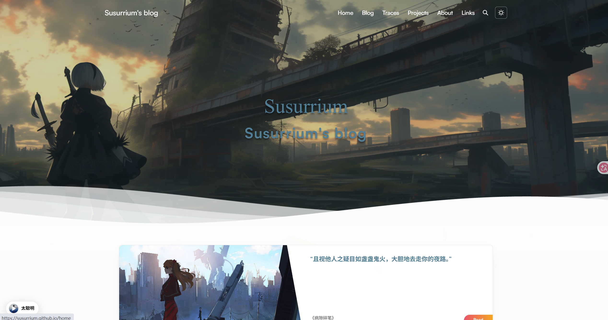
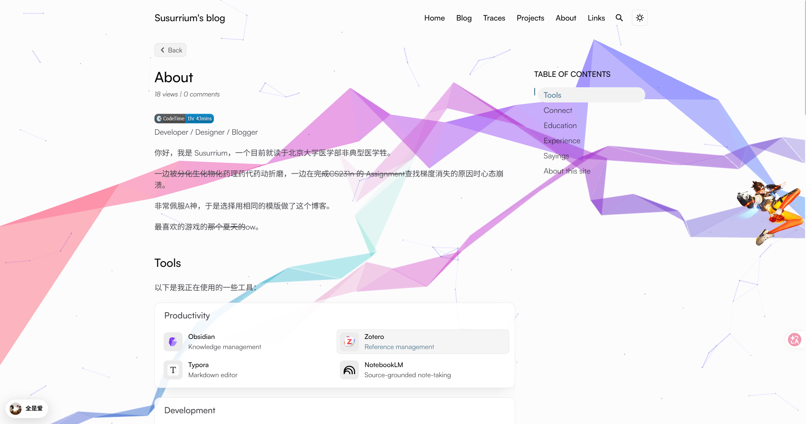
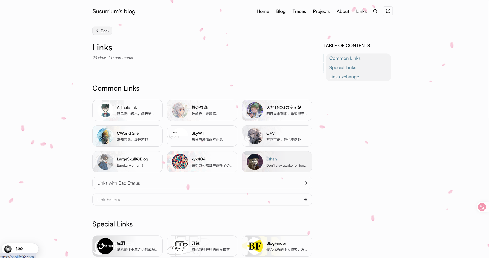
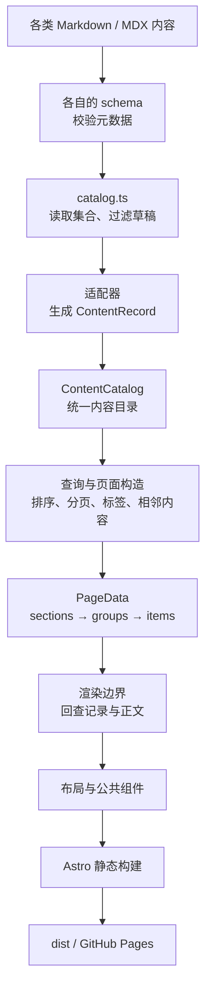
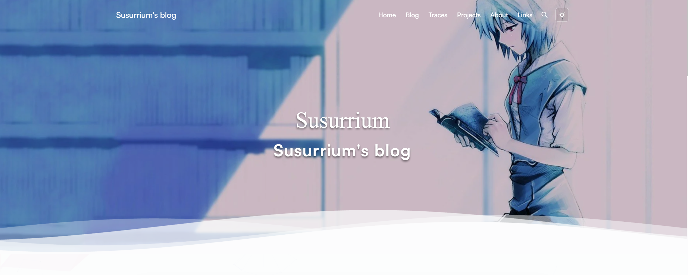
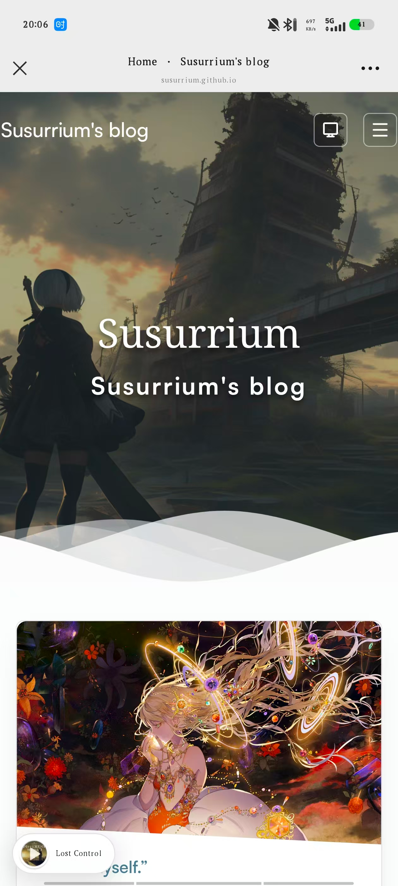
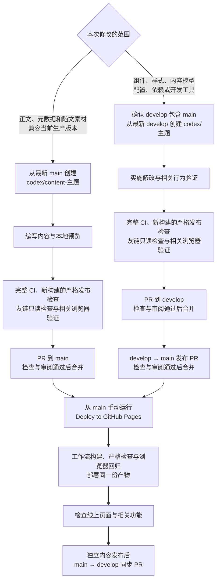
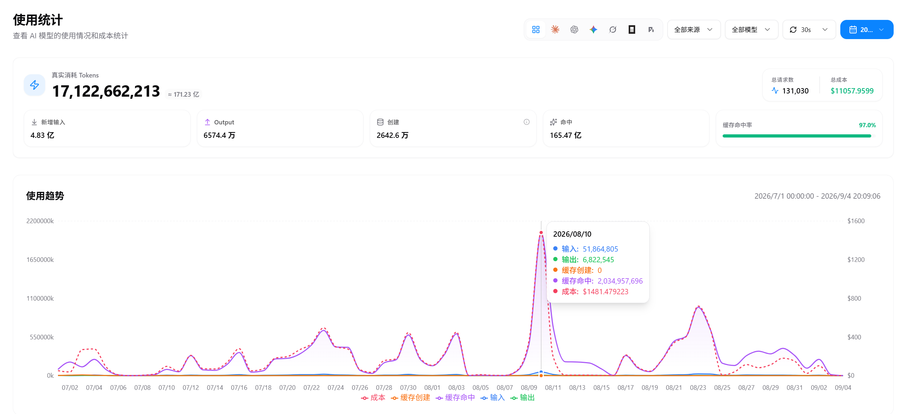
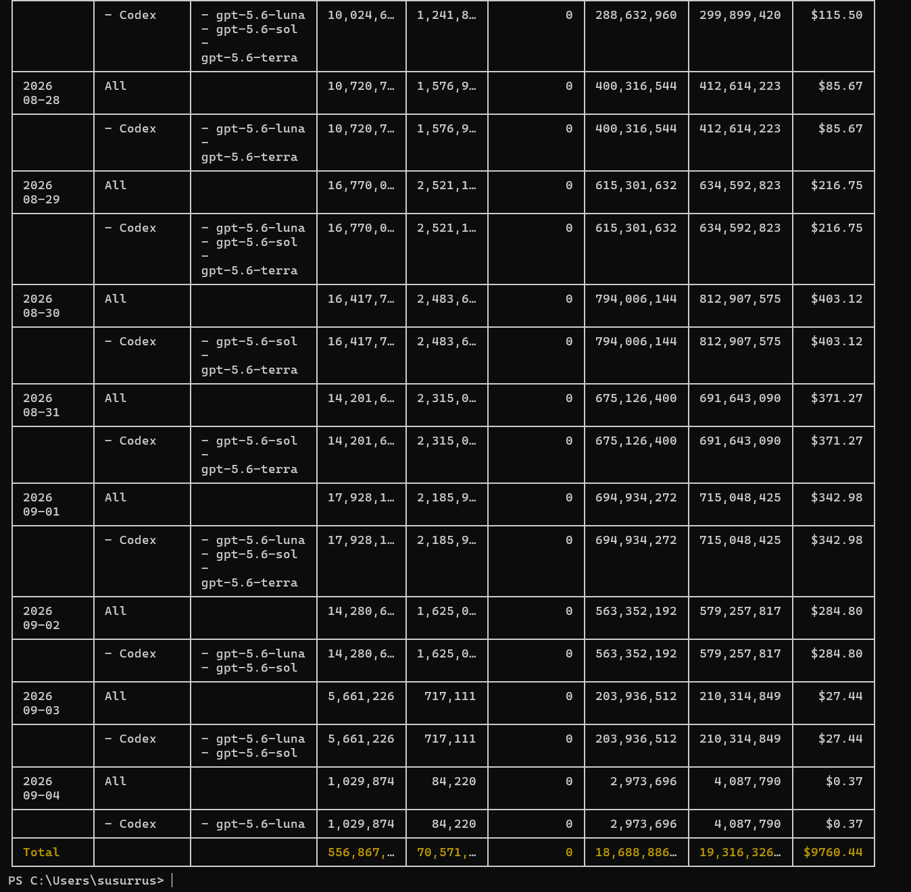

## 写在前面

很早以前，我就想有一个地方，记录自己学过的东西、做过的事情，以及一些暂时还没有答案的思考。如果这些内容恰好还能被其他人看到，带来哪怕一点点启发或帮助，那就更好了。

为此，我考虑过不少内容发布方式：

首先是知乎、微信公众号这种一般图文社交媒体，它们的的用户多，但对于个人博客来说平台上内容和读者都过多过杂，我觉得不太适合博客内容。

然后是掘金、CSDN、博客园这样的技术社区，也和我的写作需求比较接近。不过我总觉得自己能力有限，还不太配在上面发表太多内容，以免污染数据库。😵‍💫😵‍💫

最后就是个人博客，虽然缺点很明显：开发、部署和维护都需要自己处理，而且很可能没有多少人看，最后真正的读者只剩下自己。但是对于这个用来长期保存个人记录的地方，我能自己决定内容怎样组织、页面怎样呈现，也能亲自设计和调整其中的交互，这种吸引力还是很大的。

并且我首先需要的，就是一个能让自己继续记录的地方。有人愿意读，是额外的惊喜。

开始之前，我以为这只是一个简单的前端项目，做几个页面，再加上文章列表和详情，应该很快就能完成。真正动手之后，才逐渐发现：

> 做出一个能用的博客很容易，做出一个好用，自己愿意长期使用、也愿意继续维护的博客，却没有想象中简单。

现在的 [Susurrium’s blog](https://susurrium.github.io/)，经历了从零开发、尝试复刻、Fork 和重构，才终于有了今天的样子。

项目源码放在 [GitHub：Susurrium/susurrium.github.io](https://github.com/Susurrium/susurrium.github.io)，感兴趣的话，欢迎查看实现、参考使用，或者交流建议。

这条路线并不高效，有些地方甚至绕了很远。但它让我接触到了一个前端项目从想法到上线的完整过程，也让我开始认真考虑一些最初没有想过的问题：内容应该怎样组织，组件之间怎样协作，页面切换后谁来清理资源，以及下一次修改时，我还能不能理解自己写过的代码。

## 一、现在这个博客能做什么

### 1.1 页面与整体外观

网站根路径是一个独立入口，用视频背景和文字介绍建立第一印象，随后进入位于 `/home` 的主页。


_入口页主要负责网站氛围与个人介绍。_

Home 是网站的内容入口，包含 Hero、随机 Saying、个人简介、最近 Blog 与 Trace、Blog 时间线，以及教育经历、居住地和 GitHub 贡献记录等模块。



_Home 集中展示近期内容与部分个人信息。_

其他主要页面各自承担相对明确的职责：

- **Blog、Traces、Sayings**：展示对应类型的内容列表，并提供详情与标签入口。
- **Projects**：展示项目、课程笔记、GPG 公钥和支持方式。
- **About**：集中介绍个人情况、使用中的工具、联系方式和经历。
- **Links**：保存友情链接、特殊链接、链接历史及本站的友链申请信息。

这些页面共享导航、页脚、字体、颜色和基础排版，支持浅色、深色主题与移动端布局。具体的布局和装饰则根据页面用途调整。

我很喜欢 Arthals 博客阅读页面的简洁和整体感。对于需要认真阅读的文章，清楚的层级、合适的行宽和稳定的排版更有价值。所以，阅读页尽量保持克制，Home、About、Links 等页面则保留更多变化。





### 1.2 内容组织：我的 Blog、Trace 和 Saying

我想保存的内容，并不总适合写成一篇完整文章。

有些事情需要交代背景、解释机制，再认真组织结论；有些只是一次调试、一个生活片段，或者尚未发展完整的想法；还有些内容，值得保存的可能只有一句话。

因此，我根据自己的写作习惯，设计了三种内容类型。

**Blog** 承载完整文章，例如学习笔记、技术教程、项目总结，以及对某个问题较为系统的思考。正文保存在 `src/content/blog/`。

**Trace** 保存生活、思考和过程记录。它允许内容停留在某个具体时刻，不要求每次都整理出完整的教程或结论。正文保存在 `src/content/traces/`。

**Saying** 保存短句、引文和一些值得留下来的表达，可以附带原文、作者、出处和补充说明。正文保存在 `src/content/sayings/`。

这三种类型只是我目前采用的内容划分。复用这个项目时，可以按照自己的需要定义 Notes、Projects、Publications 或其他类型。

自定义类型需要在源码中补充对应的字段定义、内容适配、类型注册、展示策略和路由，再接入公共查询与渲染流程。已有的排序、分页、标签和卡片能力可以继续复用。具体采用几种类型、分别叫什么，取决于自己准备怎样组织内容。

内容类型与标签也承担不同的职责。标签描述主题，类型决定字段、展示方式和阅读场景。一篇技术文章与一条开发随想可以具有相同主题，但仍然分别进入 Blog 和 Trace。

筹备博客时，Saying 已经有了五条，Blog 和 Trace 却还没有正式内容。页面、卡片和交互都准备好了，文章还没有开始写。这篇开发记录，也就成了 Blog 的起点。

### 1.3 查找内容：列表、标签、归档与搜索

进入网站之后，读者可以通过几种方式找到内容。

各类型列表提供连续浏览和分页。标签按照内容类型分别组织，Blog 的标签与 Trace、Saying 的标签各有入口。Blog 还提供年度归档和首页时间线，方便按照时间查找。

全文搜索由 Pagefind 提供，可以统一检索多种内容，再按照类型及对应标签筛选。

RSS 用于订阅更新，目前默认收录 Blog。sitemap 和 robots.txt 则负责向搜索引擎说明站点中的公开入口。

这些入口都从统一内容数据层取得数据，因此草稿状态、标签和内容身份可以保持一致。

### 1.4 阅读与交互

文章阅读页主要提供正文相关的能力：

- 桌面与移动端文章目录；
- 代码高亮和代码复制；
- 数学公式、GitHub 风格提示块与 Mermaid 图表；
- 图片放大；
- 前后篇导航；
- 评论和访问量；
- 按内容策略显示的版权、分享与二维码区域。

全站交互包括主题切换、移动端导航、站内页面切换和音乐播放器。播放器在站内切换时保留状态，进入阅读页后使用更紧凑的形式，尽量减少对正文的遮挡。

这些能力需要共同处理首次加载、重复进入页面、浏览器前进后退和资源释放。相关实现会在后面的开发经历中展开。

### 1.5 附加组件与维护工具

个人页面还包含 GitHub 贡献热力图、WakaTime 编程时间统计、Residence 地图、点击粒子、花瓣和 About 页面的小人等组件。编程时间以 Code Time 和 AI Code Time 两项文字展示，分别对应 VS Code 和 Codex 桌面 AI 活动的累计时长，数据由独立统计仓库定时更新。

不同页面使用不同的效果配置，阅读页关闭装饰效果。设备条件、页面可见性和用户的减少动画偏好，也会影响效果是否运行。

维护方面，项目提供了 Hero 与卡片裁剪工作台、响应式图片生成、资源预算检查和友链健康检查。工作台用于调整图片构图，其他脚本则帮助确认图片清单、资源体积和链接状态。

这些组件有的来自 Pure，有的参考或复用了其他站点的实现，也有一些由项目自行开发。具体来源、版本与复用条件保存在仓库的来源台账和素材说明中。

### 1.6 项目的基础

当前项目 Fork 自 [Arthals-Ink](https://github.com/zhuozhiyongde/Arthals-Ink)，主题和组件基础来自 [astro-pure](https://github.com/cworld1/astro-theme-pure)。

成熟的文章排版、搜索、目录、分页和组件体系，为这个博客提供了起点。后续修改围绕我的需求展开，包括独立入口、多种内容类型、统一内容数据层、个人页面，以及音乐、地图和视觉效果的生命周期管理。

资源维护和发布流程也逐渐成为项目的一部分。最终，项目采用静态构建，部署到 GitHub Pages。

## 二、三次尝试，才找到合适的起点

### 2.1 第一次：完全自己开发

最开始，我决定从零开发。

当时的想法很直接：先做个人主页，再逐步补上博客、项目、友链、搜索、深色模式和文章详情。这个过程中，我第一次比较完整地接触了 Astro、Markdown 内容集合、Pagefind、响应式布局、静态构建和 GitHub Actions。

项目最后形成了一个可以运行的雏形，保存在 [Susurrium/homepage](https://github.com/Susurrium/homepage)。

但我始终不满意。

页面之间缺少统一的视觉语言，首页结构比较松散，数据与组件之间的关系也没有整理清楚。功能逐渐增加，代码却越来越难以扩展。有些地方能够使用，但再往前改一步，就需要先处理许多之前留下来的问题。

最关键的是，我自己不愿意继续使用它。

这种不满意很难归结为某一个 Bug。一个页面可以没有明显错误，各项功能也都存在，但它们放在一起，仍然没有形成一个自己认可的整体。继续往上添加东西，也没有改善这种感觉。

于是，这个项目被搁置了一段时间。

### 2.2 第二次：参考 Arthals-Ink，尝试复刻

后来到了暑假，我有了更多空闲时间，也有了 Tibo 提供的额度，于是决定重新开始。

这次我先回头看了原项目的问题，希望找到一个更明确的设计方向。很自然地，我想到了 Arthals 的博客。

虽然至今仍然不认识 A 神，但我一直很佩服他。Arthals-Ink 的 Blog 页面简约、有整体感，也适合阅读相对严肃的文章。我希望保留这种阅读体验，同时让其他页面更加丰富，加入自己喜欢的组件和表达。

于是，我开始参考不同的博客和个人网站，尝试理解它们的结构，再把喜欢的部分组合起来。

有了参考之后，视觉目标确实清楚了许多。真正实现起来，却又遇到了新的问题。

一张 Hero 图片，在桌面上构图合适，到了手机上可能就把主体裁掉了；一个动画第一次进入页面时正常，站内切换几次之后却可能重复运行；地图和播放器接入之后，还需要考虑加载时机、状态保存和服务失败。

我花了很多时间接近参考站点的效果，结果仍然不理想。有些地方看起来像了，换一个视口或者进入另一个页面，又会暴露出新的问题。为了修正表面效果而不断增加的判断，也让后续修改越来越困难。

那段时间确实比较挫败。投入精力之后，反而更加清楚地看到了自己与目标之间的距离。

### 2.3 第三次：Fork，然后重新理解项目

最后，我决定直接 Fork Arthals-Ink。

主题、文章系统、搜索、目录和分页已经存在，我可以在一个成熟的基础上继续工作。不过，接下来很快就发现，已有项目内部也存在许多需要理解的关系。

改动一个路由，要检查导航、RSS、sitemap 和 canonical；增加一种内容类型，要处理字段、卡片、标签、搜索和归档；替换一张图片，还要考虑裁剪、下载体积与来源记录。

即使只是接入一个外部脚本，也需要弄清它会创建哪些对象、注册哪些监听器，以及页面离开后怎样释放这些资源。

因此，Fork 之后的主要工作逐渐变成了阅读和整理：哪些实现可以保留，哪些能力适合复用，哪些边界需要重新设计，以及自己的需求应该进入项目的哪一层。

选择成熟项目作为起点之后，仍然需要花时间理解它。只有理解已有关系，后面的修改才有依据。

## 三、几个真正改变项目结构的问题

### 3.1 多种内容怎样共享能力

增加 Trace 和 Saying 时，很容易想到分别复制 Blog 的列表、详情和查询逻辑，再调整字段与样式。

但随着首页、标签、搜索和归档一起参与，重复逻辑就会迅速增多。同一条内容可能在多个页面出现，每个页面都要决定怎样过滤草稿、如何排序、图片从哪里来，以及标签链接应该指向哪里。

因此，我为项目增加了统一的内容数据层。

各内容类型保留各自的集合与 schema。读取集合之后，适配器把它们转换成统一的内容记录，再交给查询与页面组织逻辑。



生产代码中，只有 `src/lib/content-layer/catalog.ts` 直接调用 `getCollection()`。页面通过统一目录取得内容，避免分别维护多套读取规则。

目前的内容记录采用带类型区分的联合类型：

```ts
type ContentRecord = BlogRecord | TraceRecord | SayingRecord
```

公共部分保存身份、标题、标签等内容语义，各类型专属字段留在对应分支中。这样，Saying 可以自然地没有日期，也能够保留作者与出处。扩展新类型时，也需要同步扩展相应的类型定义与适配逻辑。

页面数据固定使用：

```text
PageData → sections → groups → items
```

例如，Home 可以把最近 Blog 和最近 Trace 放进不同分组；归档页可以按年份组织文章；详情页可以保存当前文章与前后相邻内容。分组表达的是这些内容在当前页面中的作用。

详情页需要前后篇导航，但每篇文章只需要保存最多三条关联记录，即上一条、当前条目和下一条。渲染时再根据稳定标识回查所需数据，避免为每篇详情重复携带整个集合。

卡片也遵循相同的职责划分。相同视觉复用一个渲染组件，内容层负责把不同字段转换成组件需要的数据；视觉差异明显的卡片，则保留相应的展示形式。

这套结构让后续修改的位置更明确：字段进入 schema 与适配器，查询进入内容层，页面组织进入 PageData，视觉效果交给组件。

### 3.2 Hero：从调整图片，变成重新整理几何关系

Home 的 Hero 是我印象最深的例子之一。

一开始，只是想调整图片位置。后来发现桌面端与移动端需要分别保存构图，于是增加尺寸判断；滚动到边界时出现问题，再补充滚动逻辑；固定媒体的高度与 Hero 容器不一致，又需要继续增加计算。

每一次修改都有眼前的理由。叠加到后面，代码却变得很难理解。稍微修改一个尺寸，其他条件下的表现就可能发生变化，我也越来越难判断下一次调整会影响哪里。

最后，我重新整理了 Hero 的数据、裁剪配置与可见性计算。



目前，桌面与手机的焦点、缩放分别保存。工作台复用正式页面的媒体组件和舞台比例，调整时就能够看到标题、遮罩与波浪共同作用后的构图。

滚动部分集中计算固定媒体应该显示多少：先根据 Hero 底部在视口中的位置，求出容器剩余可见高度，再把这一比例映射到媒体实际高度，用 `clip-path` 连续裁剪。Hero 完全离开后隐藏媒体，反向滚动时仍然沿用同一套关系。

这种计算也考虑了容器与媒体高度略有差异的情况。



重构之后，几何计算可以独立测试，媒体定位与滚动可见性也各有职责。继续调整图片时，需要理解的范围清楚了许多。

这件事也影响了我后来使用 AI Agent 的方式。遇到问题时，需要先判断当前实现的关系是否清楚。若几种职责已经混在一起，继续增加条件，很可能只是让下一次修改更困难。

### 3.3 页面切换之后，脚本还在做什么

许多交互第一次加载时都能正常工作，问题往往出现在第二次、第三次进入页面之后。

项目使用 Astro 的 `ClientRouter` 进行站内导航。导航过程中会交换页面内容，脚本执行与状态管理因此需要考虑完整刷新之外的情况。Astro 官方文档也专门说明了脚本重新执行与页面生命周期事件的行为。[Astro View transitions 文档](https://docs.astro.build/en/guides/view-transitions/)

对于这个博客，不同组件需要分别处理。

音乐播放器使用持久实例，跨页面保留状态，同时避免重复订阅。地图属于页面内部资源，接近视口时初始化，离开页面时释放，并区分旧任务与新任务，防止已经取消的异步加载影响后来重新进入的页面。

文章图片缩放共享一个文档级实例，但当前文章的图片需要在合适的时机绑定，导航前关闭并解除关联。评论组件保存自己的实例，组件断开连接后执行销毁。

装饰效果还要考虑当前页面、设备条件、页面可见性和减少动画偏好。

因此，接入一个效果之后，仍然需要回答几个具体问题：什么时候启动，什么时候暂停，哪些状态需要保留，什么时候必须销毁，以及再次进入时如何重建。

把这些条件处理清楚之后，效果才真正成为网站中可以反复使用的一部分。

### 3.4 外部服务失败，也要有清楚的结果

地图、音乐、评论、统计与 GitHub 数据都涉及外部服务。它们能够丰富网站，也带来了额外的加载和失败条件。

当前项目按照不同功能采用了相应的处理方式：

- 入口视频无法播放时保留 poster；
- 地图按需加载，失败时保留本地静态展示；
- 音乐在首次交互后加载，失败时显示重试与歌单入口；
- GitHub 贡献数据取得失败时显示中性状态，缺失数据标为未知；
- 用户选择减少动画时，关闭对应的非必要效果。

这些处理需要保留失败的含义。贡献数据缺失时，不能把空白解释为零次贡献；播放器没有取得歌单时，也应该让用户知道当前状态。

资源本地化解决另一部分问题。可以随网站分发的媒体保存在仓库中，公共图库生成不同尺寸的候选，页面根据视口选择合适资源。仍然需要访问外部服务的部分，分别记录用途和允许范围。

页面正文和基础导航能够独立存在，附加服务则根据实际状态提供功能或明确的失败提示。

### 3.5 发布之前，还需要知道自己将要发布什么

项目后期，我花了不少时间处理页面之外的事情。

哪个分支代表生产版本？历史检查点中的内容是否应该恢复？旧组件有没有被当前实现替代？临时文章是否仍然会进入构建？图片、字体和个人信息的公开范围是否明确？

这些问题都需要具体检查。

尤其是临时内容：文件被 `.gitignore` 忽略，只能说明 Git 默认不会跟踪它。只要文件还在内容加载器会读取的目录中，它就可能进入构建。所以，用于预览卡片和测试布局的临时文章，在正式构建前仍然需要移出。

为此，项目逐渐补充了文档检查、ESLint、Astro 类型检查、行为测试、静态构建、浏览器回归，以及 RSS、sitemap、canonical、外部资源和体积预算检查。

严格发布检查针对最新的 `dist/` 执行。浏览器回归则继续检查移动目录、键盘交互、Hero 滚动、页面切换、音乐持久性和效果清理等实际行为。

这些检查有各自的证明范围。构建成功说明产物能够生成；浏览器回归检查指定环境中的页面行为；外部服务是否可用，还需要结合当次实际响应判断。

## 四、使用与开发

日常使用主要是创建、修改和发布内容。开发更新则处理组件、样式、内容模型、配置、依赖与工具的变化，也包括首次将项目改造成自己的站点。

两者采用不同的分支路线，最终都从 `main` 手动部署：



两条路线发布前共用以下检查命令：

```powershell
node scripts/run-sequential.mjs ci
bun run release:gate
bun run links:check:dry
```

完整 CI 包含新构建；`release:gate` 本身已经包含严格模式，检查最新产物；友链命令采用只读模式，不修改链接数据。重新构建前，需要先停止占用本项目 `dist/` 的预览。

Pages 发布源选择 GitHub Actions。目标修改进入 `main` 并通过检查后，在 Actions 中手动运行 `Deploy to GitHub Pages`，选择 `main`。工作流完成验证和部署之后，再检查线上结果。

### 4.1 使用：编写与发布内容

以下流程从仓库已经完成站点配置、依赖已经安装的状态开始。首次建立自己的站点，见下一节的开发与配置说明。

#### 创建内容分支

先检查当前工作区，保留已有修改。确认文章可以使用当前生产版本的字段、模板和组件后，从最新 `main` 创建分支：

```powershell
git fetch origin
git switch main
git pull --ff-only origin main
git switch -c codex/content-my-first-post
```

这个分支保存本次内容修改及其随文素材。

#### 创建正文与随文素材

在仓库根目录执行：

```powershell
bun run new --type blog --folder --slug my-first-post --language 中文 "我的第一篇文章"
```

命令创建独立文章目录和 `index.md`，默认写入 `draft: true`。Blog 至少需要标题、摘要和发布日期。

下面是一个完整示例。引用封面与正文图片前，先把相应文件放进文章目录：

```markdown
---
title: 我的第一篇文章
description: 记录这次实践的背景、实现过程和结果。
publishDate: 2026-10-18T15:00:00+08:00
language: 中文
tags:
  - 开发
draft: false
heroImage:
  src: ./cover.webp
  alt: 湖面与岸边的树木
---

## 事情的起点

正文从这里开始。


```

页面已经输出文章标题，正文从二级标题开始。

文章专用图片与正文放在一起，使用相对路径引用，迁移和维护会方便一些。JPG、PNG、WebP 等满足资源预算的图片都可以使用，格式根据内容和透明度需求选择。

需要固定公开地址或多处共用的文件，可以放进 `public/`。这里的文件会原样进入发布目录，因此需要直接控制源文件的体积。视频和音频还要检查播放方式、poster、移动端表现及使用权。

文章目录名会影响公开链接。这个示例对应 `/blog/my-first-post`，发布后移动或重命名时，需要检查已有引用。

#### 预览与检查

启动开发服务器：

```powershell
bun run dev
```

普通列表和详情页在开发环境中也过滤草稿。通过这些页面预览时，需要把文章设为 `draft: false`，提交前再核对公开状态。未来发布日期不会自动延迟公开，发布状态仍由草稿字段控制。

检查正文、目录、代码、图片和移动端布局。完成后停止开发服务器，执行本节开头的完整检查。

搜索索引在构建时生成。需要检查最新搜索结果时，使用新产物启动生产预览：

```powershell
bun run preview -- --host 127.0.0.1 --port 4321
```

结合本次内容检查详情、列表、标签、搜索与 RSS 中的展示。

#### 提交与发布

确认正文、元数据、素材及公开范围后，只暂存本次涉及的文件，提交并推送文章分支，创建 `codex/content-my-first-post → main` 的 PR。

等待 `validate`、`browser-regression` 与审阅通过后合并，再按照共同发布流程手动部署。上线后检查文章与相关入口，并通过 `main → develop` PR 同步生产基线。

如果写作过程中发现文章需要新的 schema、组件或样式，先完成相应开发更新及发布，再使用这些能力发布内容。

### 4.2 开发：建立自己的站点与更新网站功能

#### 首次建立自己的站点

复用项目时，先在 GitHub Fork 仓库，保留需要使用的 `main`、`develop` 分支，再克隆自己的仓库。

项目使用的版本以 `.node-version`、`package.json` 和锁文件为准。本文整理时，Node 固定为 `24.18.0`，Bun 为 `1.4.0`，Astro 为 `7.3.1`，astro-pure 为 `1.4.7`。

进入仓库后安装依赖与 Mermaid 构建环境：

```powershell
bun install --frozen-lockfile
bun run setup:mermaid
```

随后按照下面的功能开发流程创建工作分支，完成站点配置与资源替换。

网站名称、作者、简介、导航、页脚和集成配置主要位于 `src/site.config.ts`。个人简介、联系方式、经历、入口、音乐、居住地和效果配置分别保存在 `src/data/` 中。

还需要检查头像、签名、视频、Hero 图片、友链、项目入口、二维码，以及 Waline、Umami、WakaTime 统计和音乐服务等配置。WakaTime 的采集与读取凭据分别保存在本机配置和统计仓库的 GitHub Actions Secret 中，网站读取公开的累计时长快照。来源与使用条件分别记录在仓库的 `docs/SOURCE_LEDGER.md` 和 `docs/THIRD_PARTY_NOTICES.md` 中。

部署地址由 `astro.config.ts` 的 `site` 配置决定。当前仓库还包含站点专属检查，更换域名时，需要同步核对预检、严格发布脚本、浏览器回归的 canonical 目标，以及页面中的固定链接。

如果使用 GitHub Pages 仓库子路径，还需要继续适配站内链接与静态资源地址。`site`、`base` 与发布地址之间的关系，可以参考 [Astro GitHub Pages 部署指南](https://docs.astro.build/en/guides/deploy/github/)。

公共图库更新后，执行：

```powershell
bun run generate:media-images
bun run verify:media-images
```

Hero 与卡片构图可以在本地 `/tools/card-crop-review` 调整，导出后通过应用脚本更新正式配置。具体步骤见仓库中的 `docs/MEDIA_WORKBENCH.md`。

完成这些配置后，这个仓库才逐步成为自己的站点。

#### 创建功能分支并实施修改

首次配置和后续功能更新都从 `develop` 开始。先更新远端引用，确认 `develop` 已包含 `main` 的生产提交；缺少时，先通过 `main → develop` PR 同步。

保留当前工作区修改后，创建分支：

```powershell
git fetch origin
git switch develop
git pull --ff-only origin develop
git switch -c codex/my-feature
```

页面路由、布局与组件分别维护在对应目录；公共数据进入 `src/data/`，内容语义和查询进入内容层，浏览器交互则需要遵守现有生命周期约定。

自定义内容类型也属于这条开发路线。需要一起考虑字段、适配、注册、路由，以及它是否参与首页、标签、搜索和 RSS。

开发过程中可以运行 `bun run dev` 查看修改。功能完成后，执行相关行为测试、共同的完整检查，并验证受到影响的页面交互。涉及站内切换时，需要反复进入和离开页面，确认状态保存及资源清理符合预期。

#### 集成与发布

检查实现、测试、说明文档和最终差异后，提交并推送工作分支，创建 `codex/my-feature → develop` 的 PR。

检查与审阅通过后合并，再创建 `develop → main` 发布 PR。发布 PR 同样通过检查和审阅之后，进入共同的 Pages 手动发布流程。

网站功能上线后，日常写作继续使用上一节的内容发布流程。

## 五、最后的一些杂谈

### 5.1 AI Agent 在这个过程中的使用

从这个项目诞生的契机开始，它就离不开 AI。

因为它正是某次我 Codex 额度用不完时，决定正式开始的产物。

后来的许多工作，也离不开 Codex 和 Claude 老师的帮助。从结构分析、代码实现，到问题定位、测试设计、分支整理和发布验证，它们参与了项目的很多部分。

项目中不少代码，我已经分不清哪些由自己手写，哪些由它生成。不过，我觉得也没有必要刻意区分。代码最终进入项目，就需要由我理解、判断、修改和承担后果。

我也经常听到一些类似的说法：“要是没有 AI，……”“一直使用 AI，你自己最后会变成什么样？”

这里也说一点自己的想法，或者说暴论。

AI 当然是工具，但它是一个非常强大的工具。

当一个人能够有效使用 AI 时，这种使用能力本身就会成为个人能力的一部分，而且会变得越来越重要。它已经能够改变我接触问题、学习知识和完成项目的方式，这种改变值得认真对待。

与此同时，AI 强大，也让我更加明确地意识到自己还有很多东西需要学习。

以这次开发为例，Codex 给出的方案有很多次都很差，甚至可以说很丑陋；也有很多次，我只是让它完成一个很小的任务，最后仍然出现各种细小的 Bug。

这些问题需要有人发现，也需要有人判断应该怎样处理。目标是否合理，方案是否满足要求，代码是否值得继续维护，仍然需要我自己作出决定。

所以，我关心的学习目标也逐渐变得清楚：理解问题、判断方案，以及在已经拥有 AI 的条件下，把事情做得更好。

想起曾经看过的一个树洞，大致是这样：

dz问：

> AI 的出现，会不会让人类失去独立分析、判断和思考的能力？

某字母君答：

> 蒸汽机的出现，会不会让人类失去骑马的能力？

> 电气化的普及，会不会让人类失去亲手生火的能力？

> 计算机的出现，会不会让人类失去记忆与计算的能力？

工具改变之后，我们使用能力的方式也会改变。对我来说，值得继续追问的是：哪些事情现在可以做得更好，哪些判断仍然需要亲自承担，以及自己应该怎样学习，才能真正用好这些工具。

这里顺便附上两张当时的 Token 用量截图。





### 5.2 接下来的事情

博客完成基础建设并上线之后，接下来的主线任务，就是发布 Blog、Trace 和其他内容。希望能够坚持更新，不要鸽掉。`¯\_(ツ)_/¯`

开发方面，我还想继续整理内容数据层，研究怎样把这个带有许多个人配置的项目，做成更方便复用的博客模板。如果其中一些改进也适合 Pure，希望能够整理出来，尝试完成自己的第一个开源贡献。

从完全自己开发，到尝试复刻，再到 Fork 和重构，我走了一条并不直接的路。但这段经历让我逐渐知道，怎样让内容、页面、交互与发布流程共同组成一个可以继续维护的项目。

现在，该往里面写东西了。

P.S.：博客里有一个隐藏彩蛋。如果你认为自己发现了，可以带着发现过程来找我确认，并领取神秘奖励。😎😎
